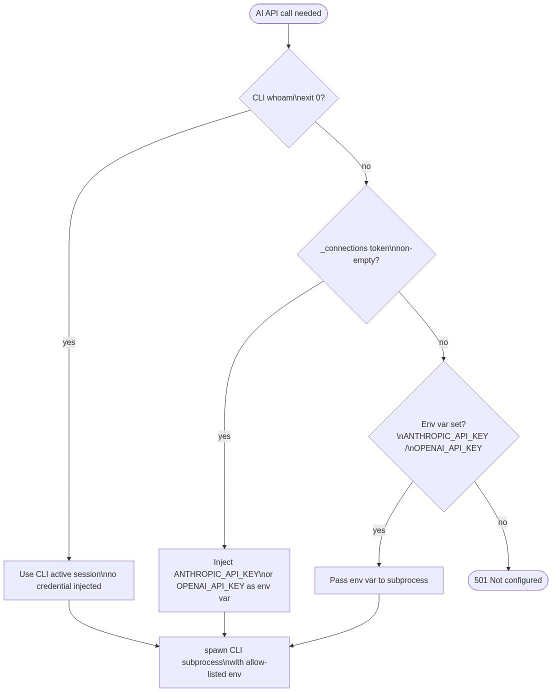

# Backend Spec — Agent & CLI Environment

> **Superseded for CLI invocation and login flows.**
> The subprocess model described in this file has been replaced by the CLI runner service.
> See [cli-runner.md](cli-runner.md) for the current architecture.
>
> This file is retained as reference for the credential resolution order (§4) and
> process limit values (§6), which still apply inside the runner container.


> Scope: how AI provider CLIs (`claude`, `openai`) are discovered, authenticated, and invoked.

> The CLI environment is distinct from the connections credentials store — it describes the

> **subprocess context** in which AI agent tasks run.


---


## 1. Overview


BlogHub drives AI tasks (content generation, gate checks, metadata extraction) by shelling out

to the Anthropic and OpenAI CLIs rather than calling the HTTP APIs directly with a stored key.

This means:


- Credentials never pass through the BlogHub backend as plaintext; they live in the CLI's own

  config directory managed by the provider's tooling.

- `claude login` / `openai login` open a browser window — the CLI handles the full OAuth dance

  and writes credentials to a well-known config path.

- The backend only needs to know if the CLI is authenticated; it proves this with a cheap test

  invocation (`claude whoami` / `openai whoami`), not by reading raw token files.


![diagram-1](https://mermaid.ink/img/c2VxdWVuY2VEaWFncmFtCiAgICBwYXJ0aWNpcGFudCBGIGFzIEZyb250ZW5kIChTZXR0aW5ncykKICAgIHBhcnRpY2lwYW50IEIgYXMgQmFja2VuZAogICAgcGFydGljaXBhbnQgQyBhcyBDTEkgKGNsYXVkZSAvIG9wZW5haSkKICAgIHBhcnRpY2lwYW50IFAgYXMgUHJvdmlkZXIKCiAgICBGLT4-QjogR0VUIC9hcGkvY29ubmVjdGlvbnMve2lkfS9vYXV0aC1zdGFydAogICAgQi0-PkI6IHJlc29sdmUgQ0xJIGJpbmFyeSAoUEFUSCAvIGVudiBvdmVycmlkZSkKICAgIGFsdCBDTEkgYmluYXJ5IG5vdCBmb3VuZAogICAgICAgIEItLT4-RjogeyBhdmFpbGFibGU6IGZhbHNlIH0KICAgICAgICBOb3RlIG92ZXIgRjogZmFsbCBiYWNrIHRvIEFQSSBrZXkgZm9ybQogICAgZWxzZSBDTEkgYXZhaWxhYmxlCiAgICAgICAgQi0-PkM6IHNwYXduOiBjbGF1ZGUgbG9naW4gLS1wcmludC1sb2dpbi11cmwKICAgICAgICBDLS0-PkI6IGF1dGggVVJMIChmaXJzdCBzdGRvdXQgbGluZSkKICAgICAgICBCLS0-PkY6IHsgYXZhaWxhYmxlOiB0cnVlLCBmbG93OiAiY2xpX2Jyb3dzZXIiLCB1cmwsIHBvbGxfdXJsIH0KICAgICAgICBGLT4-UDogb3BlbiBwb3B1cCB0byB1cmwKICAgICAgICBOb3RlIG92ZXIgUDogVXNlciBncmFudHMgcGVybWlzc2lvbgogICAgICAgIFAtPj5DOiBhdXRoIGNvbXBsZXRpb24gc2lnbmFsCiAgICAgICAgQy0-PkM6IHdyaXRlIGNyZWRlbnRpYWxzIHRvIGNvbmZpZyBkaXIKICAgICAgICBsb29wIGV2ZXJ5IDIgcyAobWF4IDUgbWluKQogICAgICAgICAgICBGLT4-QjogR0VUIC9hcGkvY29ubmVjdGlvbnMve2lkfS9jbGktbG9naW4tc3RhdHVzCiAgICAgICAgICAgIEItPj5DOiBjbGF1ZGUgd2hvYW1pIC8gb3BlbmFpIHdob2FtaQogICAgICAgICAgICBDLS0-PkI6IGV4aXQgMCArIHVzZXJuYW1lCiAgICAgICAgICAgIEItLT4-RjogeyBzdGF0dXM6ICJjb25uZWN0ZWQiLCB1c2VybmFtZSB9CiAgICAgICAgZW5kCiAgICAgICAgRi0-PkY6IGNsb3NlIHBvcHVwOyByZWZyZXNoIGNvbm5lY3Rpb24gY2FyZAogICAgZW5k)


---


## 2. CLI Discovery


The backend resolves the CLI binary in this order:


| Priority | Source |

|----------|--------|

| 1 | `ANTHROPIC_CLI_PATH` / `OPENAI_CLI_PATH` env var (absolute path) |

| 2 | Standard `PATH` lookup (`shutil.which('claude')` / `shutil.which('openai')`) |

| 3 | Well-known install locations: `~/.local/bin`, `~/.npm-global/bin`, `/usr/local/bin` |


If the CLI binary cannot be found, `GET /api/connections/{id}/oauth-start` returns

`{ available: false }` and the frontend falls back to showing the API key form only.


---


## 3. Browser Login Flow (CLI-based)


The CLI manages the OAuth dance internally. The backend only captures the URL to present,

then polls for completion.


| Step | Actor | Action |

|------|-------|--------|

| 1 | Frontend | calls `GET /api/connections/{id}/oauth-start` |

| 2 | Backend | resolves CLI binary; if missing → `{ available: false }` |

| 3 | Backend | spawns `claude login --print-login-url` / `openai login --print-url` (non-blocking; captures first stdout line as URL) |

| 4 | Backend | stores `{ pid, conn_id, state_token, started_at }` in `_cli_login_pending[conn_id]` |

| 5 | Backend | returns `{ available: true, flow: "cli_browser", url: "https://…", poll_url: "/api/connections/{id}/cli-login-status" }` |

| 6 | Frontend | opens `url` in a 600 × 700 popup |

| 7 | User | completes auth in the popup tab |

| 8 | CLI process | receives auth completion; writes credentials to config dir |

| 9 | Frontend | polls `GET /api/connections/{id}/cli-login-status` every 2 s (max 5 min) |

| 10 | Backend | on each poll: runs `claude whoami` / `openai whoami`; if exit 0 → marks `connected` |

| 11 | Backend | returns `{ status: "connected", username: "…" }` |

| 12 | Frontend | closes popup (if still open); refreshes connection card |


### Credential file locations


| Provider | Default credential store | Override env var |

|----------|--------------------------|-----------------|

| Anthropic | `~/.claude/credentials` | `CLAUDE_CONFIG_DIR` |

| OpenAI | `~/.config/openai/` | `OPENAI_CONFIG_DIR` |


The backend **never reads raw token values** from these files — only uses the CLI's own

`whoami` to verify auth state.


### Polling endpoint


```

GET /api/connections/{conn_id}/cli-login-status


Response 200:

  { "status": "pending" }           # CLI process still running; keep polling

  { "status": "connected",          # whoami succeeded

    "username": "acisse@email.com" }

  { "status": "error",              # CLI exited non-zero

    "error_message": "Login timed out" }

```


- Polling ceases client-side after `status` is `connected` or `error`, or after 5 minutes.

- The `_cli_login_pending` entry is deleted as soon as a terminal state is written.


---


## 4. Credential Resolution Order (for AI API calls)


When the backend needs to authenticate an AI provider call, it resolves in this order:


| Priority | Source | Check |

|----------|--------|-------|

| 1 | CLI active session | `claude whoami` / `openai whoami` exits 0 |

| 2 | Stored token | `_connections[id].token` is non-empty |

| 3 | Environment variable | `ANTHROPIC_API_KEY` / `OPENAI_API_KEY` is set |

| 4 | → error | 501 Not configured |


If resolution succeeds at priority 1, the backend passes no credential to the subprocess —

the CLI uses its own session. If at priority 2 or 3, the key is injected via environment

variable into the CLI subprocess (never as a CLI argument).





---


## 5. Subprocess Environment


All CLI invocations must run in a controlled, allow-listed environment:


```python

import os, tempfile, shutil


# Build a clean env — never pass os.environ wholesale

env = {

    "HOME":   os.environ["HOME"],

    "PATH":   os.environ["PATH"],

    # Config dir overrides (blank string = use default)

    "CLAUDE_CONFIG_DIR": os.environ.get("CLAUDE_CONFIG_DIR", ""),

    "OPENAI_CONFIG_DIR": os.environ.get("OPENAI_CONFIG_DIR", ""),

    # On Windows: temp dirs must be user-writable

    "TEMP": os.environ.get("TEMP", ""),

    "TMP":  os.environ.get("TMP",  ""),

    # Inject API key only when CLI session not available (priority 2/3)

    # "ANTHROPIC_API_KEY": token,  ← injected only when needed, never logged

}

# Per-task working directory, deleted after completion

work_dir = tempfile.mkdtemp(prefix="bloghub_agent_")

try:

    result = subprocess.run([cli_path, ...], env=env, cwd=work_dir, ...)

finally:

    shutil.rmtree(work_dir, ignore_errors=True)

```


**Critical rules:**

- Never include `MEDIUM_CLIENT_SECRET`, `SECRET_KEY`, `DATABASE_URL`, or any BlogHub-internal

  secrets in the subprocess env.

- API keys injected as env vars are **not logged** — see `security.md § 1`.

- Working directory is isolated per-request and always cleaned up in a `finally` block.


---


## 6. Process Limits


| Limit | Variable | Default |

|-------|----------|---------|

| Max duration (wall clock) | `AGENT_TIMEOUT_SECONDS` | `60` |

| Max stdout + stderr size | `AGENT_MAX_OUTPUT_BYTES` | `524288` (512 KB) |

| Graceful shutdown grace | *(hardcoded)* | 5 s (SIGTERM → SIGKILL) |


Timeout handling:

```python

try:

    proc.wait(timeout=int(os.environ.get("AGENT_TIMEOUT_SECONDS", 60)))

except subprocess.TimeoutExpired:

    proc.terminate()

    time.sleep(5)

    proc.kill()

    raise AgentTimeoutError(conn_id)

```


Output cap: read stdout in chunks; stop reading and append `[output truncated]` once

`AGENT_MAX_OUTPUT_BYTES` is reached. The process is allowed to continue to completion

but further output is discarded.


---


## 7. Environment Variables Reference


| Variable | Default | Purpose |

|----------|---------|---------|

| `ANTHROPIC_CLI_PATH` | *(PATH lookup)* | Absolute path to `claude` binary |

| `OPENAI_CLI_PATH` | *(PATH lookup)* | Absolute path to `openai` binary |

| `CLAUDE_CONFIG_DIR` | `~/.claude` | Override Anthropic credential directory |

| `OPENAI_CONFIG_DIR` | `~/.config/openai` | Override OpenAI credential directory |

| `AGENT_TIMEOUT_SECONDS` | `60` | Max wall-clock seconds per CLI subprocess |

| `AGENT_MAX_OUTPUT_BYTES` | `524288` | Output cap per subprocess invocation |

| `ANTHROPIC_API_KEY` | *(not set)* | Fallback key when CLI session unavailable |

| `OPENAI_API_KEY` | *(not set)* | Fallback key when CLI session unavailable |

