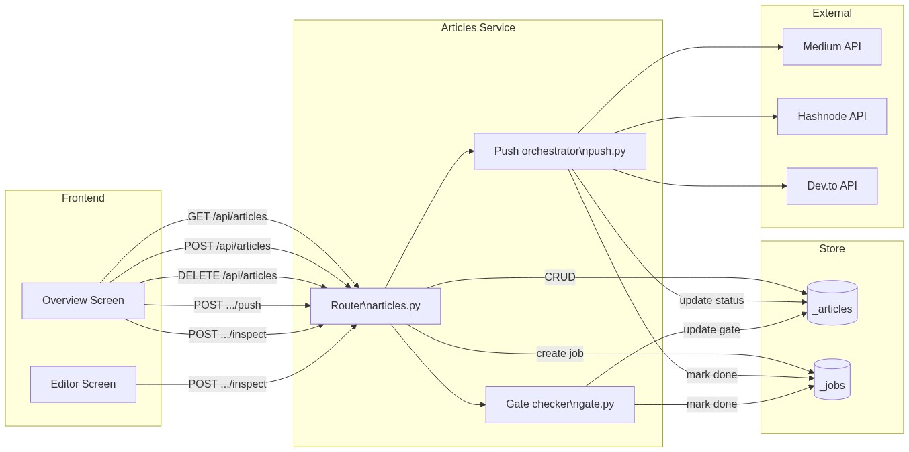
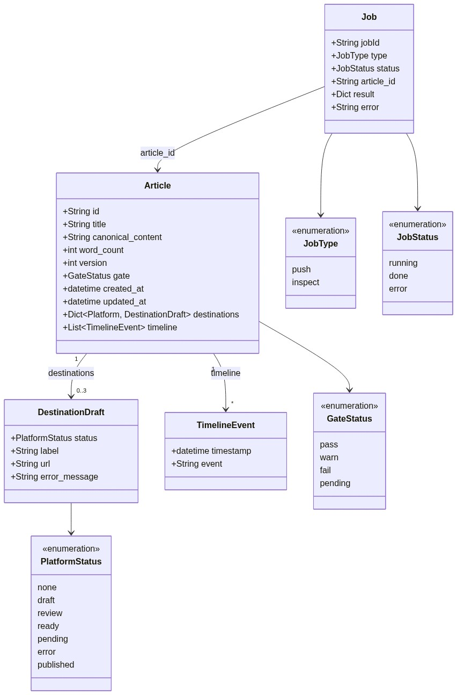

# Service — Articles

---

## What it does

The Articles service is the **central domain service** of BlogHub. It owns the full lifecycle
of an article: creation, editing metadata, bulk deletion, and triggering async operations
(push to publishing platforms, gate inspection). It is the only service that writes to the
article store and the job store.

---

## Main features

| Feature | Endpoint | Notes |
|---------|----------|-------|
| List articles | `GET /api/articles` | Filter, sort, paginate; each item includes gate badge + per-platform destination status |
| Get article | `GET /api/articles/{id}` | Full article with content, gate, destinations — editor entry point |
| Create article | `POST /api/articles` | Blank record; returns `id` for editor navigation |
| Autosave article | `PATCH /api/articles/{id}` | Debounced save of `title` and/or `content`; returns `updated_at + word_count`; `409` on version conflict |
| Bulk delete | `DELETE /api/articles` | Atomic; `409` blocks on published articles; `force: true` overrides |
| Push drafts | `POST /api/articles/{id}/push` | Async — returns `202 + jobId`; background push to Medium / Hashnode / Dev.to |
| Gate inspect | `POST /api/articles/{id}/inspect` | Async — runs word count, section integrity, tail-check; sets `gate` = pass / warn / fail |
| Publish state | `GET /api/articles/{id}/publish-state` | Per-destination draft status snapshot for the publish screen |

---

## Main dependencies

| Dependency | Direction | Purpose |
|------------|-----------|---------|
| `_articles` store | read/write | Persistent article records (in-memory) |
| `_jobs` store | write | Creates job records consumed by the Jobs service |
| Platform API clients | outbound (push) | Calls Medium / Hashnode / Dev.to APIs during push |
| Gate checker | internal | Runs readability / structural analysis during inspect |
| Connections service | read (indirect) | Reads `_connections` to verify platform creds before push |

---

## Where it lives

```
backend/
  routers/
    articles.py       ← FastAPI router; all 5 endpoints
  store/
    memory.py         ← _articles dict + _jobs dict
  schemas/
    articles.py       ← Pydantic models (ArticleSummary, CreateArticleRequest, …)
  services/
    gate.py           ← gate inspection logic
    push.py           ← platform push orchestration
```

---

## Execution pattern

```
Sync (CRUD):
  Request → router validates → store read/write → JSON response

Async (push / inspect):
  Request → create job record (status=running) → 202 Accepted
      ↓ (background)
  job logic runs → updates _articles + _jobs
      ↓ (polling)
  GET /api/jobs/{jobId} → terminal status
```

- CRUD endpoints are fully synchronous.
- `push` and `inspect` return `202 Accepted` immediately with a `jobId`.
- The caller polls `/api/jobs/{jobId}` (2 s interval, max 60 s) until `done | error`.
- In the current in-memory backend, async jobs complete synchronously; the first poll
  always returns `done`. Production would use a task queue (Celery / ARQ).

---

## Dataflow



---

## UML — domain model



---

## API contract

See [swagger.yaml](swagger.yaml) in this folder.

Key response shapes at a glance:

| Schema | Key fields |
|--------|-----------|
| `ArticleSummary` | `id · title · updatedAt · wordCount · gate · destinations · recentTimeline` |
| `ArticleListResponse` | `items[] · total · page · pageSize` |
| `AsyncAccepted` | `jobId · status: "running"` |
| `CreateArticleResponse` | `id · title · createdAt` |
