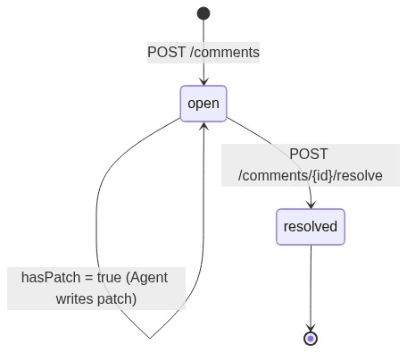
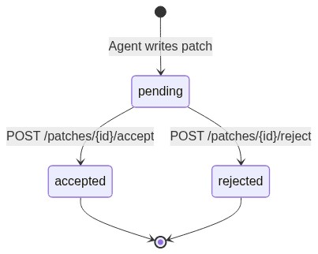

# Comments & Patches Service

## What It Does

Manages the review lifecycle for an article. Stores inline comments (created from the
`/comment <text>` editor command or by selecting text and clicking "Add comment") and
AI-generated diff patches (created by the Agent service in response to a comment).
Exposes CRUD endpoints so the editor's Comments and Patches panels reflect real
persisted state rather than the static arrays in the current prototype.

---

## Main Features

| Feature | Description |
|---------|-------------|
| Comment creation | Inline `/comment <text>` command or text-selection → `POST /api/articles/{id}/comments`. Stores `author`, `text`, and optional `anchor` (the selected source text). |
| Comment list | `GET /api/articles/{id}/comments` — ordered oldest-first; unresolved first. |
| Comment resolve | `POST /api/articles/{id}/comments/{cid}/resolve` — marks `resolved = true`. |
| Patch list | `GET /api/articles/{id}/patches` — all patches (pending / accepted / rejected). |
| Patch accept | `POST /api/patches/{pid}/accept` — applies the diff to `Article.body`, marks `state = accepted`. Triggered by editor "Accept" button or CLI `patch apply <id>`. |
| Patch reject | `POST /api/patches/{pid}/reject` — marks `state = rejected`; body unchanged. |

---

## Comment State Machine



## Patch State Machine



---

## Dependencies

| Dependency | Why |
|------------|-----|
| `articles` service / store | Validate the `article_id`; write updated `Article.body` when a patch is accepted. |
| `agent` service | Agent writes patches (hasPatch, Patch record) — comments-patches service stores them. |
| `jobs` service | Agent uses jobs to signal when a patch is ready; no direct dependency from this service. |

---

## File Tree (planned)

```
backend/
  routers/
    comments.py     # /api/articles/{article_id}/comments routes
    patches.py      # /api/patches/{patch_id}/accept|reject routes
  services/
    comments_service.py
    patches_service.py
  store/
    memory.py       # shared store — comments and patches keyed by article_id
```

---

## Execution Pattern

```
POST /api/articles/{article_id}/comments
  │
  ├─ Validate article exists
  ├─ Create Comment { id, author, text, anchor?, createdAt, resolved=false, hasPatch=false }
  └─ Return 201 Comment

POST /api/articles/{article_id}/comments/{comment_id}/resolve
  │
  ├─ Validate article + comment exist
  ├─ Set comment.resolved = true
  └─ Return 200 Comment

POST /api/patches/{patch_id}/accept
  │
  ├─ Lookup Patch by patch_id (any article)
  ├─ Read Article.body
  ├─ Apply patch: replace first occurrence of patch.removed with patch.added
  ├─ Write updated body → articles store
  ├─ Set patch.state = accepted
  └─ Return 200 Patch

POST /api/patches/{patch_id}/reject
  │
  ├─ Lookup Patch by patch_id
  ├─ Set patch.state = rejected
  └─ Return 200 Patch
```

---

## Dataflow


---

## UML Class Diagram


