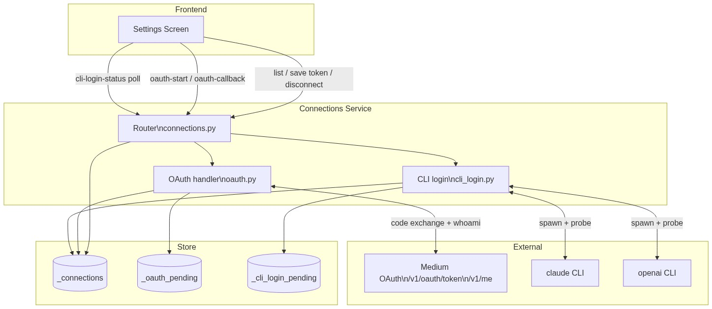
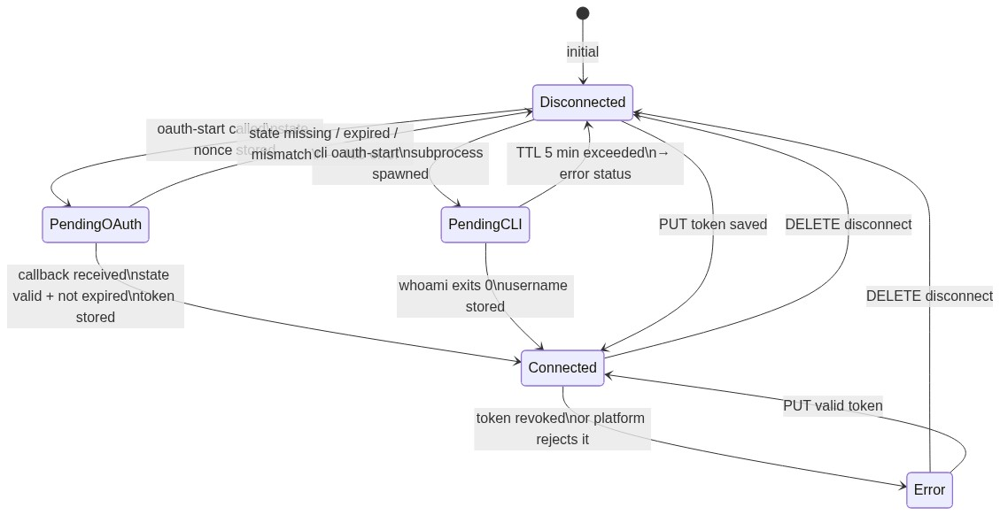
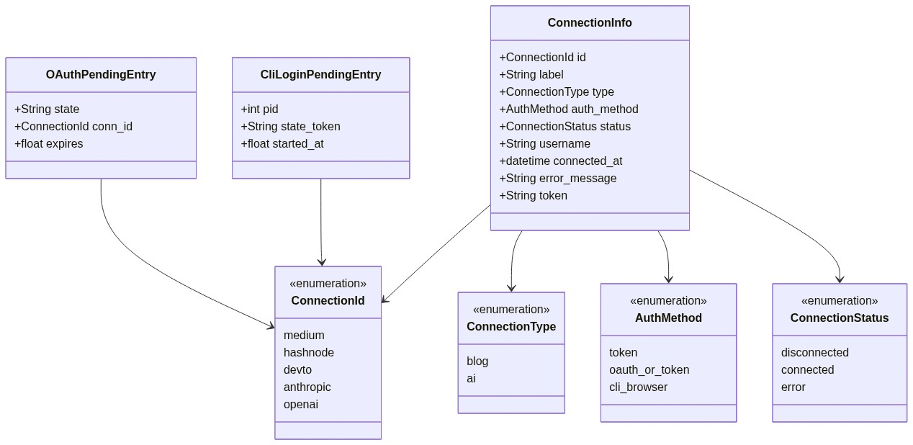

# Service — Connections

---

## What it does

The Connections service owns **all credential management** for BlogHub. It is responsible for
storing, retrieving, and invalidating API tokens for the three publishing platforms (Medium,
Hashnode, Dev.to) and two AI providers (Anthropic, OpenAI). It also orchestrates all
authentication flows: provider OAuth 2.0, and CLI-based browser login for AI provider CLIs.

Connections are explicitly **isolated from article state** — they survive store resets and
represent a user's long-term trust grants, not ephemeral article data.

---

## Main features

| Feature | Endpoint | Auth method |
|---------|----------|-------------|
| List all connections | `GET /api/connections` | all |
| Save API token / PAT | `PUT /api/connections/{id}` | all |
| Disconnect | `DELETE /api/connections/{id}` | all |
| Start Medium OAuth popup | `GET /api/connections/medium/oauth-start` | Medium only |
| Handle Medium OAuth redirect | `GET /api/connections/medium/oauth-callback` | Medium only |
| Start CLI browser login | `GET /api/connections/{id}/oauth-start` | anthropic · openai |
| Submit loopback callback URL | `POST /api/connections/{id}/submit-code` | anthropic only |
| Poll CLI login completion | `GET /api/connections/{id}/cli-login-status` | anthropic · openai |

### Auth method matrix

| ID | Type | Browser login | Token / key |
|----|------|--------------|-------------|
| `medium` | blog | OAuth 2.0 Authorization Code popup | Integration token optional |
| `hashnode` | blog | — | Personal Access Token |
| `devto` | blog | — | API Key |
| `anthropic` | ai | `claude auth login` → loopback OAuth | API Key (fallback) |
| `openai` | ai | `codex login --device-auth` → device code | API Key (fallback) |

---

## Main dependencies

| Dependency | Direction | Purpose |
|------------|-----------|---------|
| `_connections` store | read/write | Token storage + status per connection |
| `_oauth_pending` store | read/write | Single-use state nonces for OAuth CSRF protection |
| `MEDIUM_CLIENT_ID` env var | config | OAuth application identity |
| `MEDIUM_CLIENT_SECRET` env var | config | Server-side code exchange (never sent to browser) |
| Medium API (`/v1/oauth/token`, `/v1/me`) | outbound | Token exchange + username fetch |
| CLI runner service (`http://localhost:8001`) | outbound | Delegates all CLI auth operations |
| Security rules | cross-cutting | See [security.md](../security.md) |
| CLI environment | cross-cutting | See [agent-environment.md](../agent-environment.md) |

---

## Where it lives

```
backend/
  routers/
    connections.py    ← FastAPI router; all connection + OAuth endpoints
  schemas/
    connections.py    ← Pydantic models (ConnectionInfo, SaveTokenRequest, OAuthStartResponse)
  store/
    memory.py         ← _connections dict, _oauth_pending dict
  services/
    cli_runner.py     ← HTTP client to the cli-runner Docker service (port 8001)

cli-runner/
  main.py             ← FastAPI app; spawns claude / codex CLIs, handles auth flows
  Dockerfile          ← python:3.12-slim + node + @anthropic-ai/claude-code + @openai/codex
docker-compose.yml    ← cli-runner service; volumes: claude-config, codex-config
```

---

## Execution pattern

```
Token CRUD (sync):
  Request → validate token → _connections write → JSON response

OAuth start (sync):
  Request → generate state nonce → store in _oauth_pending → return provider URL

OAuth callback (sync, server-initiated):
  Provider redirect → validate state (pop from _oauth_pending) →
      POST /token to provider → GET /me → store token → return callback HTML

CLI login start (semi-async):
  Request → resolve CLI binary → spawn subprocess (non-blocking) →
      capture first stdout line (auth URL) → store PID in _cli_login_pending → return URL

CLI login status poll (sync):
  Request → run `claude whoami` probe → if exit 0 → mark connected → return status
```

---

## Dataflow



---

## OAuth state machine



---

## UML — domain model



---

## Security constraints (summary)

Full detail in [security.md](../security.md).

| Rule | Enforcement |
|------|------------|
| State nonce is single-use | `_oauth_pending.pop(state)` — removal on first access |
| State TTL 10 min | validated on callback; stale entries purged lazily |
| Client secret never in browser | code exchange happens server-side only |
| `postMessage` origin validated | callback page uses injected `APP_ORIGIN`, never `'*'` |
| Token never logged | `scrub()` helper applied to all log lines |
| CLI env is allow-listed | `os.environ` never passed wholesale to subprocess |
| CLI credential files never read | only `whoami` probe used to verify auth state |

---

## API contract

See [swagger.yaml](swagger.yaml) in this folder.

Key response shapes at a glance:

| Schema | Key fields |
|--------|-----------|
| `ConnectionInfo` | `id · label · type · auth_method · status · username · connected_at` |
| `OAuthStartResponse` | `available · url` |
| `SaveTokenResponse` | `id · status · username · error_message` |
