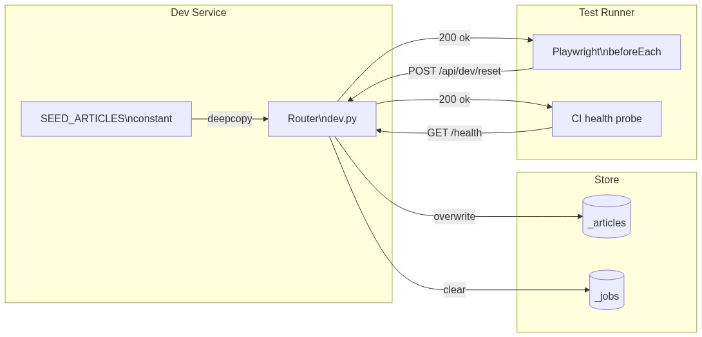
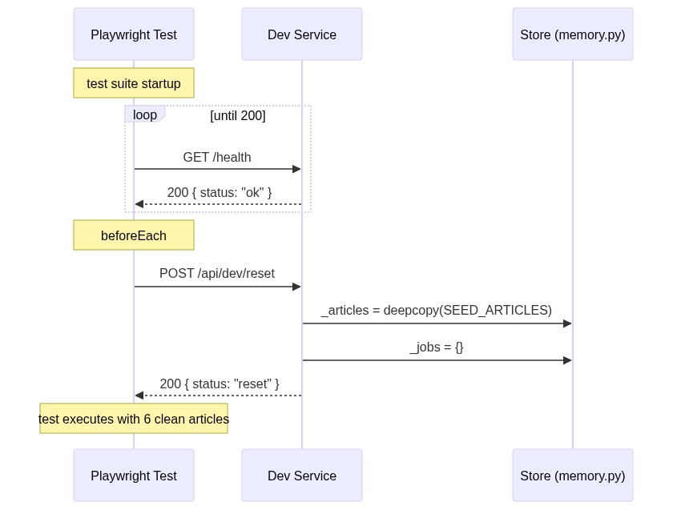

# Service — Dev

---

## What it does

The Dev service provides **test isolation and readiness signalling** for the Playwright
test suite and local development tooling. It has no product function and must not be
reachable in production.

Two endpoints only:
- `POST /api/dev/reset` — restores `_articles` and `_jobs` to their seeded defaults
- `GET /health` — returns `{"status": "ok"}` when the server process is up

---

## Main features

| Feature | Endpoint | Used by |
|---------|----------|---------|
| Reset store to seed | `POST /api/dev/reset` | Playwright `beforeEach` hooks |
| Health check | `GET /health` | Playwright `webServer.url`, CI readiness probe |

### What reset does and does not touch

| Store | Reset? | Reason |
|-------|--------|--------|
| `_articles` | ✅ yes | Restore 6 seeded articles for deterministic test state |
| `_jobs` | ✅ yes | Clear any pending / stale jobs from prior test |
| `_connections` | ❌ no | Credentials outlive article state — same as real usage |
| `_oauth_pending` | ❌ no | Not article state |
| `_cli_login_pending` | ❌ no | Not article state |

---

## Main dependencies

| Dependency | Direction | Purpose |
|------------|-----------|---------|
| `_articles` store | write | Reset to seed |
| `_jobs` store | write | Reset to `{}` |
| `SEED_ARTICLES` constant | read | 6-article seed fixture embedded in `memory.py` |

No external calls, no auth, no async.

---

## Where it lives

```
backend/
  routers/
    dev.py          ← FastAPI router; reset + health endpoints
  store/
    memory.py       ← _articles, _jobs, seed_articles fixture
```

### Production gating

```python
# In main.py — only mount the dev router when APP_ENV != "production"
import os
if os.environ.get("APP_ENV") != "production":
    app.include_router(dev_router)
```

---

## Execution pattern

```
POST /api/dev/reset (sync):
  Request → _articles = copy.deepcopy(SEED_ARTICLES)
           → _jobs = {}
           → return { status: "reset" }

GET /health (sync):
  Request → return { status: "ok" }
```

Both endpoints are synchronous, in-process mutations with no I/O.

---

## Dataflow



---

## UML — requests and effects



---

## API contract

See [swagger.yaml](swagger.yaml) in this folder.
