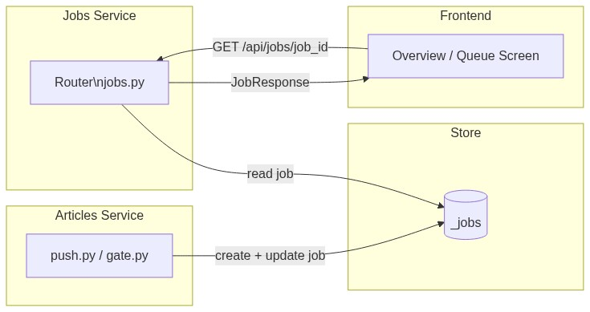
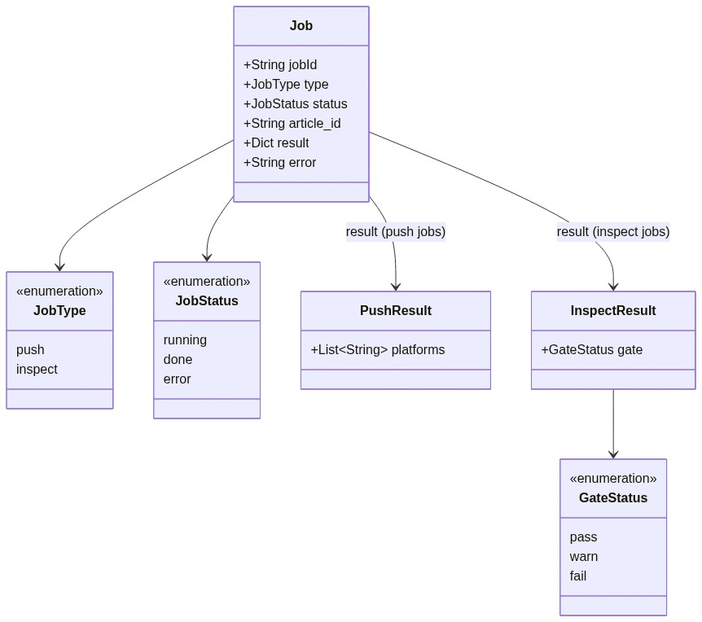

# Service — Jobs

---

## What it does

The Jobs service is the **async polling counterpart** to the Articles service. When an
article action (push or inspect) returns `202 Accepted`, it creates a job record that
the frontend can poll here until a terminal state is reached. The Jobs service is
intentionally read-only from the frontend's perspective — only the Articles service
writes to `_jobs`.

---

## Main features

| Feature | Endpoint | Notes |
|---------|----------|-------|
| Poll job status | `GET /api/jobs/{job_id}` | Returns current status + result or error |

### Job lifecycle

```
Articles service writes → _jobs[job_id] = { status: running }
      ↓ (background logic)
Articles service updates → _jobs[job_id] = { status: done, result: {…} }
      ↓ (frontend polls)
GET /api/jobs/{job_id} → { status: done, result }
```

### Job types and their result payloads

| `type` | `result` when `done` |
|--------|----------------------|
| `push` | `{ platforms: ["medium", "hashnode"] }` — platforms successfully pushed |
| `inspect` | `{ gate: "pass" \| "warn" \| "fail" }` — overall gate result |

---

## Main dependencies

| Dependency | Direction | Purpose |
|------------|-----------|---------|
| `_jobs` store | read-only | Job records written by the Articles service |
| Articles service | upstream writer | Creates + updates job records; Jobs service only reads |

The Jobs service has **no outbound dependencies** — it is a pure read-through to the store.

---

## Where it lives

```
backend/
  routers/
    jobs.py         ← FastAPI router; single GET endpoint
  store/
    memory.py       ← _jobs dict (shared with Articles service)
  schemas/
    jobs.py         ← Pydantic models (JobResponse, JobType, JobStatus)
```

---

## Execution pattern

```
Sync (read-only poll):
  Request → look up _jobs[job_id] → 404 if missing → return JobResponse

No writes. No background tasks. No external calls.
```

Poll recommended interval: **2 s**. Stop after `done | error` or 60 s client-side timeout.

In the current in-memory backend, jobs are completed synchronously by the Articles service
before the `202` response is even sent — so the very first poll always returns `done`.
A production task queue (Celery / ARQ) would make this genuinely async.

---

## Dataflow



---

## UML — domain model



---

## API contract

See [swagger.yaml](swagger.yaml) in this folder.
