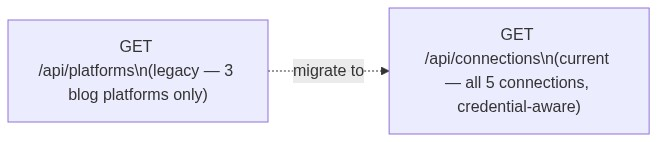
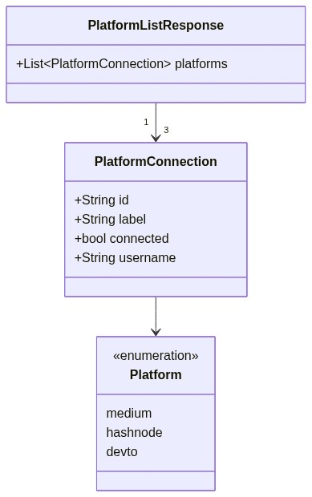

# Service — Platforms

---

## What it does

The Platforms service exposes a **legacy read-only list** of blog platform connectivity
used by the nav-bar "N platforms connected" counter on earlier screen versions (v1–v3).

> **Prefer `/api/connections` for all new UI work.** The Connections service is
> credential-aware, live, and covers all 5 connection types. The Platforms service
> returns seed-state data for the three blog platforms only.

---

## Main features

| Feature | Endpoint | Notes |
|---------|----------|-------|
| Nav-bar connectivity count | `GET /api/platforms` | Returns Medium · Hashnode · Dev.to with `connected: bool` |

---

## Main dependencies

| Dependency | Direction | Purpose |
|------------|-----------|---------|
| `_connections` store | read-only | Derives connected state from credential store |

No outbound calls, no writes, no async operations.

---

## Where it lives

```
backend/
  routers/
    platforms.py    ← FastAPI router; single GET endpoint
  store/
    memory.py       ← _connections dict (shared; read-only here)
  schemas/
    platforms.py    ← Pydantic models (PlatformConnection, PlatformListResponse)
```

---

## Execution pattern

```
Sync (read-only):
  Request → read _connections for [medium, hashnode, devto] →
      map to { id, label, connected, username } → return list
```

This is the simplest service in the backend — a pure projection over `_connections`.

---

## Dataflow



---

## Migration note



Screens using `GET /api/platforms` for the nav count should switch to
`GET /api/connections` and count `status === 'connected'` entries across all types,
or restrict to `type === 'blog'` for an equivalent result.

---

## UML — domain model



---

## API contract

See [swagger.yaml](swagger.yaml) in this folder.
