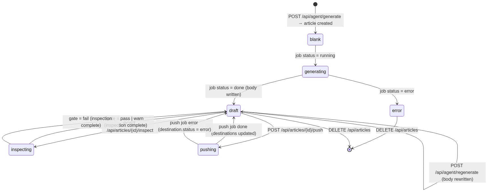
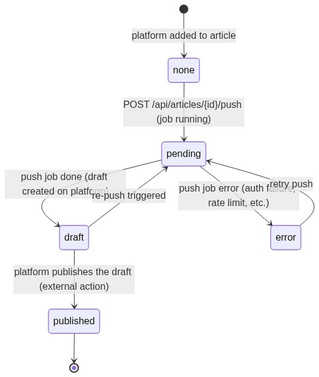
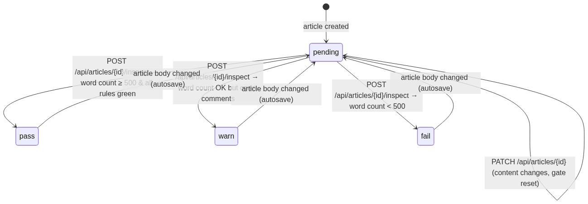
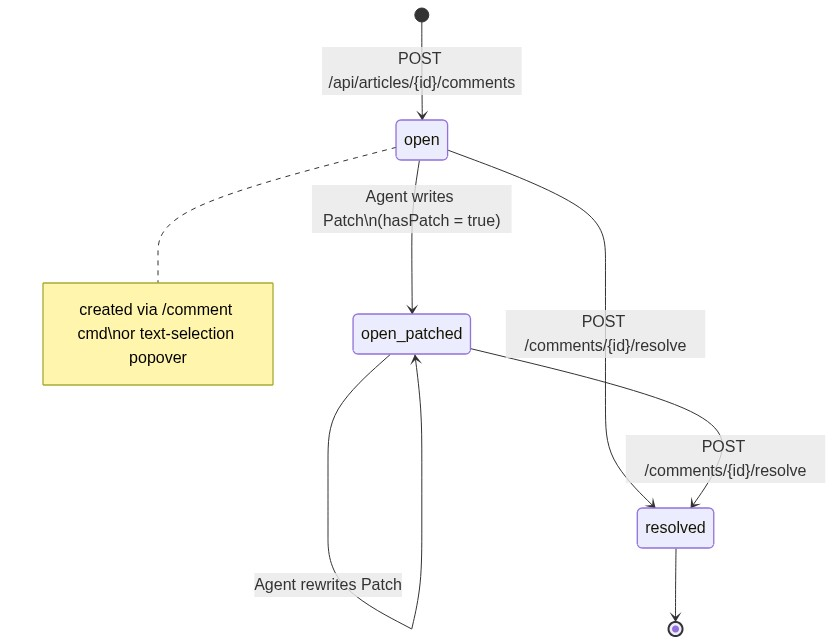
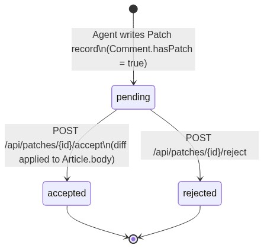
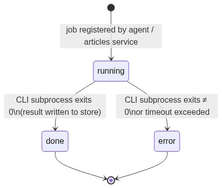
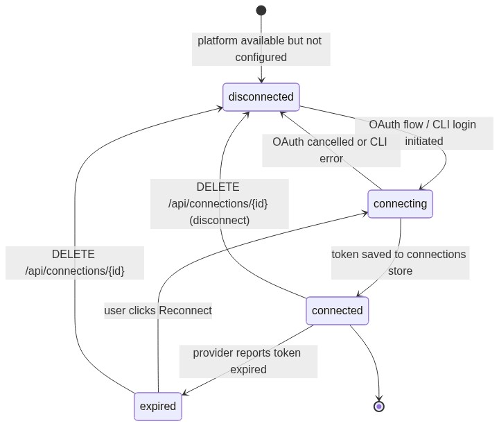

# State Diagrams

Entity lifecycle state machines for the BlogHub backend, derived from actual screen
behaviour (editor v2, create-article v1, overview v4).

---

## Article



---

## Destination (per-article, per-platform)

Each article has one `PlatformSummary` per enabled platform.



---

## Gate (inspection result per article)



---

## Comment



---

## Patch



---

## Job



---

## Connection


-> fail : POST /api/articles/{id}/inspect → word count < 500

  pass --> pending : article body changed (autosave)
  warn --> pending : article body changed (autosave)
  fail --> pending : article body changed (autosave)
```

---

## Comment


---

## Patch


---

## Job


---

## Connection


