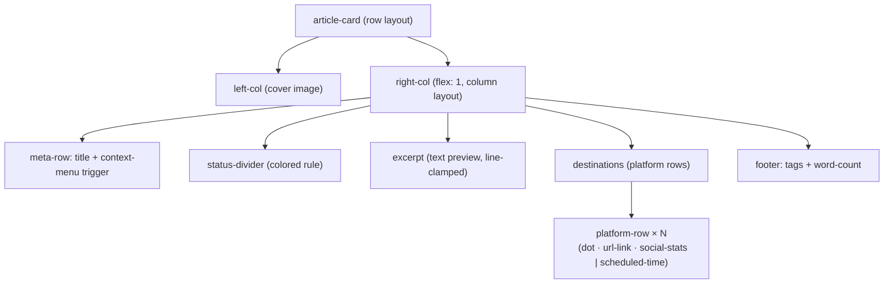

# Article Card — Component Spec

## Purpose
Displays a single article and its per-platform publication state. Used in the Overview grid.
Clicking the card selects it; platform tabs and action buttons have independent hit areas.

---

## Structure (Mermaid)



---

## Line Art — Knob Map

```
  ┌──────────────────────────┬──────────────────────────────┐  ①
  │                          │ Title of the Article     [⋮] │  ②
  │                          ├──────────────────────────────┤  ③
  │      Cover Image         │ Excerpt text preview...      │  ④⑤
  │                          │                              │
  │                          │ ● Medium    ↗  [♥][↺][✉]    │  ⑥⑦⑧
  │                          │ ● Hashnode  ↗  [♥][↺][✉]    │
  │                          │ ● Dev.to    —  09:30 Fri     │  ⑨
  │                          │                              │
  │                          │ #tag  #tag     1 234 words   │  ⑩⑪
  └──────────────────────────┴──────────────────────────────┘  ⑫⑬
```

| # | Knob(s) |
|---|---------|
| ① | `border_radius`, `border_default` / `border_selected`, `bg_default` / `bg_hover` / `bg_selected`, `card_width`, `card_min_height` |
| ② | `font_size_title`, `font_title`, `text_primary` |
| ③ | `status_bar_height`, `status_bar_color_draft` / `_error` / `_ready` / `_published` |
| ④ | `cover_width`, `cover_height`, `cover_visible` |
| ⑤ | `excerpt_visible`, `excerpt_lines`, `font_size_meta`, `text_secondary` |
| ⑥ | `dot_draft` / `dot_error` / `dot_ready` / `dot_published` / `dot_pending` / `dot_none` |
| ⑦ | `show_social_stats` |
| ⑧ | `gap_destinations`, `font_size_meta`, `font_mono` |
| ⑨ | `show_scheduled_time` |
| ⑩ | `text_secondary`, `font_size_meta` |
| ⑪ | `gap_footer` |
| ⑫ | `padding_card`, `body_direction` |
| ⑬ | `border_radius` |

---

## Knobs

These values control scaffold generation. Change a knob, re-run generation.

```yaml
# Layout
card_width: 100%
card_min_height: 140px
card_max_height: none
body_direction: row        # row | column

# Cover / left column
cover_width: 220px
cover_height: 100%         # stretches to match right-col height
cover_visible: true

# Status divider (colored rule between title and excerpt)
status_bar_height: 3px
status_bar_color_error: "#ef4444"
status_bar_color_published: "#38bdf8"
status_bar_color_ready: "#a78bfa"
status_bar_color_draft: "#252a38"

# Excerpt
excerpt_visible: true
excerpt_lines: 2           # CSS line-clamp value

# Typography
font_title: "Inter, sans-serif"
font_mono: "JetBrains Mono, monospace"
font_size_title: 14px
font_size_meta: 11px

# Colors (dark theme defaults)
bg_default: "#141824"
bg_hover: "#1b2030"
bg_selected: "#1a1f30"
border_default: "#252a38"
border_selected: "#6366f1"
text_primary: "#e8eaf2"
text_secondary: "#5a6080"

# Platform dot colors
dot_published: "#38bdf8"
dot_ready: "#a78bfa"
dot_draft: "#5a6080"
dot_error: "#ef4444"
dot_pending: "#f59e0b"
dot_none: "#252a38"

# Platform row extras
show_social_stats: true    # like / repost / comment icons per row
show_scheduled_time: true  # post time label when status = pending

# Spacing
padding_card: "12px 16px"
gap_destinations: 6px
gap_footer: 8px
border_radius: 10px
```

---

## States

| State | Status bar color | Border | Background |
|---|---|---|---|
| Default | `status_bar_color_draft` | `border_default` | `bg_default` |
| Hover | — | `border_default` + brighten | `bg_hover` |
| Selected | — | `border_selected` | `bg_selected` |
| Has error | `status_bar_color_error` | — | — |
| All published | `status_bar_color_published` | — | — |
| Ready | `status_bar_color_ready` | — | — |

---

## Platform Row (per destination)

```
● Medium    ↗  [♥ 12]  [↺ 3]  [✉ 5]
● Hashnode  ↗  [♥  4]  [↺ 1]  [✉ 0]
● Dev.to    —  09:30 Fri
```

- Dot color maps to `dot_<status>` knob
- `↗` link appears when `status = published` and a URL exists
- Social stats (likes / reposts / comments) shown when `show_social_stats: true`
- Scheduled time shown instead of social stats when `show_scheduled_time: true` and `status = pending`
- Row is dimmed (`dot_none` color) when `status = none`

---

## Scaffold Generation Instructions

When generating HTML from this spec:

1. Read the Mermaid graph as the DOM hierarchy.
2. Apply knob values as inline CSS custom properties on `.article-card` (e.g. `--cover-width`).
3. Render one card per state listed above (default, selected, error, published) side-by-side for review.
4. Include a `<style>` block at the top that maps knobs to CSS vars — no external stylesheet.
5. Use static placeholder data (title, word count, tags, dummy cover image URL).
6. Output a single self-contained `.html` file.
