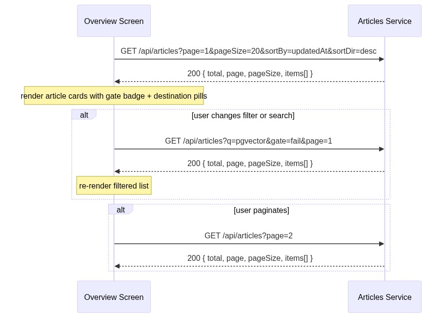
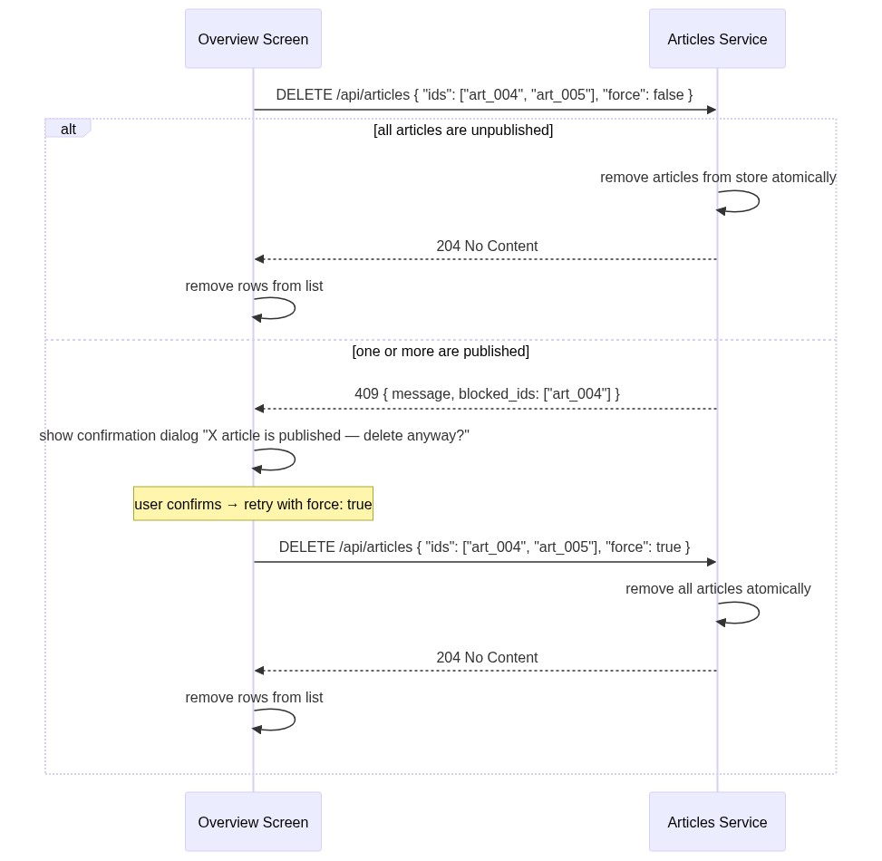

# Contract — Articles Service

**Prefix:** `/api/articles`
**Swagger:** [swagger-articles.yaml](../backend/swagger-articles.yaml)
**Store:** `backend/store/memory.py → _articles`, `_jobs`
**Touched by:** Overview screen, Editor screen, Queue screen

---

## Endpoint inventory

| Method | Path | Action | Response |
|--------|------|--------|----------|
| `GET` | `/api/articles` | List (filter · sort · paginate) | `200` list |
| `POST` | `/api/articles` | Create blank article | `201` new id |
| `DELETE` | `/api/articles` | Bulk delete | `204` / `409` if published |
| `POST` | `/api/articles/{id}/push` | Async push to platforms | `202` jobId |
| `POST` | `/api/articles/{id}/inspect` | Async gate check | `202` jobId |

---

## 1. Overview mounts — list articles

Fired on page load and each time filters / sort / pagination change.

---

## 2. Create article

Triggered by the "+ New article" button. The server creates a blank record and returns the
new `id` so the UI can navigate straight to the editor.

---

## 3. Bulk delete articles

Triggered by the bulk-select checkbox + delete action. Published articles require `force: true`.

---

## 4. Push drafts to platforms (async)

Triggered by the "Push drafts" button on an article card or the side panel.
Returns `202` immediately; UI polls `/api/jobs/{jobId}` for completion.

---

## 5. Gate inspection (async)

Triggered by the "Inspect" button. Runs the automated gate check (word count, section
integrity, etc.). Returns `202` immediately; UI polls for the gate result.

