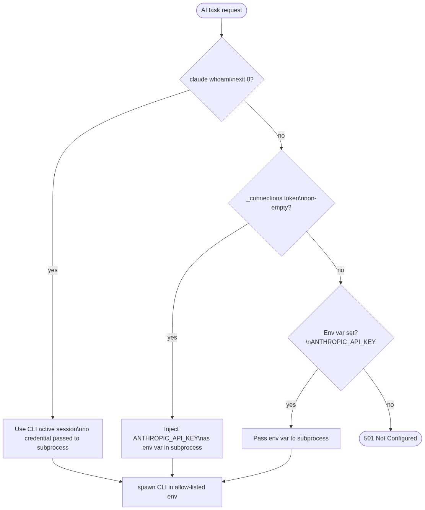

# Contract — Connections Service

**Prefix:** `/api/connections`

**Swagger:** [swagger-connections.yaml](../backend/swagger-connections.yaml)

**Store:** `backend/store/memory.py → _connections`, `_oauth_pending`, `_cli_login_pending`

**Touched by:** Settings screen

**Security reference:** [security.md](../backend/security.md)

**CLI environment reference:** [agent-environment.md](../backend/agent-environment.md)

---

## Endpoint inventory

| Method | Path | Action | Auth method |

|--------|------|--------|-------------|

| `GET` | `/api/connections` | List all 5 connections with status | all |

| `PUT` | `/api/connections/{id}` | Save API token / PAT | all |

| `DELETE` | `/api/connections/{id}` | Disconnect, remove token | all |

| `GET` | `/api/connections/{id}/oauth-start` | Start OAuth or CLI browser login | medium · anthropic · openai |

| `GET` | `/api/connections/{id}/oauth-callback` | Provider redirect handler (Medium only) | medium |

| `GET` | `/api/connections/{id}/cli-login-status` | Poll CLI login completion | anthropic · openai |

---

## Auth method by connection

| ID | Type | Browser login | API key / token |

|----|------|--------------|-----------------|

| `medium` | blog | OAuth 2.0 Authorization Code popup | Integration token (fallback) |

| `hashnode` | blog | — | Personal Access Token only |

| `devto` | blog | — | API Key only |

| `anthropic` | ai | `claude login` CLI → browser | API Key (fallback) |

| `openai` | ai | `openai login` CLI → browser | API Key (fallback) |

---

## 1. Settings mounts — list connections

---

## 2. Save API token (all connection types)

Covers all five connections: paste token → Save button → `PUT /api/connections/{id}`.

---

## 3. Disconnect

---

## 4. Provider OAuth popup flow (Medium)

Medium supports Authorization Code flow. The backend handles the code → token exchange

fully server-side; the browser never sees `client_secret`.

![diagram-4](https://mermaid.ink/img/c2VxdWVuY2VEaWFncmFtCiAgICBwYXJ0aWNpcGFudCBVSSBhcyBTZXR0aW5ncyBTY3JlZW4KICAgIHBhcnRpY2lwYW50IFBvcCBhcyBQb3B1cCBXaW5kb3cKICAgIHBhcnRpY2lwYW50IEIgYXMgQ29ubmVjdGlvbnMgU2VydmljZQogICAgcGFydGljaXBhbnQgTSBhcyBNZWRpdW0gQVBJCgogICAgVUktPj5COiBHRVQgL2FwaS9jb25uZWN0aW9ucy9tZWRpdW0vb2F1dGgtc3RhcnQKICAgIEItPj5COiBnZW5lcmF0ZSBzdGF0ZSA9IHNlY3JldHMudG9rZW5fdXJsc2FmZSgzMik7IHN0b3JlIHdpdGggMTAtbWluIFRUTAogICAgQi0tPj5VSTogMjAwIHsgYXZhaWxhYmxlOiB0cnVlLCB1cmw6ICJodHRwczovL21lZGl1bS5jb20vbS9vYXV0aC9hdXRob3JpemU_c3RhdGU94oCmIiB9CgogICAgYWx0IE1FRElVTV9DTElFTlRfSUQgbm90IGNvbmZpZ3VyZWQKICAgICAgICBCLS0-PlVJOiAyMDAgeyBhdmFpbGFibGU6IGZhbHNlLCB1cmw6IG51bGwgfQogICAgICAgIFVJLT4-VUk6IGhpZGUgT0F1dGggYnV0dG9uOyBzaG93IEFQSSBrZXkgaW5wdXQgb25seQogICAgZW5kCgogICAgVUktPj5Qb3A6IHdpbmRvdy5vcGVuKHVybCwgNjAww5c3MDAgcG9wdXApCiAgICBOb3RlIG92ZXIgUG9wLE06IHVzZXIgZ3JhbnRzIHBlcm1pc3Npb24gaW4gTWVkaXVtIHRhYgogICAgTS0-PkI6IEdFVCAvYXBpL2Nvbm5lY3Rpb25zL21lZGl1bS9vYXV0aC1jYWxsYmFjaz9jb2RlPWFiYyZzdGF0ZT14eXoKICAgIEItPj5COiBlbnRyeSA9IF9vYXV0aF9wZW5kaW5nLnBvcChzdGF0ZSkgIOKGkCBzaW5nbGUtdXNlOyB2YWxpZGF0ZTsgY2hlY2sgVFRMCiAgICBCLT4-TTogUE9TVCAvdjEvb2F1dGgvdG9rZW4geyBjb2RlLCBjbGllbnRfaWQsIGNsaWVudF9zZWNyZXQgfQogICAgTS0tPj5COiB7IGFjY2Vzc190b2tlbiwgcmVmcmVzaF90b2tlbiB9CiAgICBCLT4-TTogR0VUIC92MS9tZSAoZmV0Y2ggdXNlcm5hbWUpCiAgICBNLS0-PkI6IHsgZGF0YTogeyB1c2VybmFtZSB9IH0KICAgIEItPj5COiBzdG9yZSB0b2tlbjsgc3RhdHVzIOKGkiBjb25uZWN0ZWQ7IHVzZXJuYW1lIHNhdmVkCiAgICBCLS0-PlBvcDogMjAwIEhUTUwgcGFnZSAocG9zdE1lc3NhZ2Ugc2NyaXB0KQogICAgUG9wLT4-VUk6IHdpbmRvdy5vcGVuZXIucG9zdE1lc3NhZ2UoeyB0eXBlOiAib2F1dGgtY29tcGxldGUiLCBwbGF0Zm9ybTogIm1lZGl1bSIgfSwgQVBQX09SSUdJTikKICAgIFBvcC0-PlBvcDogd2luZG93LmNsb3NlKCkKICAgIE5vdGUgb3ZlciBVSTogbGlzdGVuZXIgdmFsaWRhdGVzIGUub3JpZ2luID09PSB3aW5kb3cubG9jYXRpb24ub3JpZ2luCiAgICBVSS0-PkI6IEdFVCAvYXBpL2Nvbm5lY3Rpb25zCiAgICBCLS0-PlVJOiB1cGRhdGVkIGNvbm5lY3Rpb24gbGlzdDsgTWVkaXVtIGNhcmQg4oaSIGNvbm5lY3RlZA==)

---

## 5. CLI browser login (Anthropic / OpenAI)

> **Architecture update:** The backend no longer spawns CLI subprocesses directly.
> All CLI operations are delegated to the CLI runner service over HTTP.
> See [cli-runner.md](../backend/cli-runner.md) for the full spec.
> The sequence below shows the same external behaviour from the UI perspective — only the
> internal Backend actor now calls the runner rather than spawning a process.

The CLI runner manages the OAuth loopback dance. The backend relays the auth URL and polls
the runner's status endpoint instead of running `whoami` itself.

![diagram-5](https://mermaid.ink/img/c2VxdWVuY2VEaWFncmFtCiAgICBwYXJ0aWNpcGFudCBVSSBhcyBTZXR0aW5ncyBTY3JlZW4KICAgIHBhcnRpY2lwYW50IFBvcCBhcyBQb3B1cCBXaW5kb3cKICAgIHBhcnRpY2lwYW50IEIgYXMgQ29ubmVjdGlvbnMgU2VydmljZQogICAgcGFydGljaXBhbnQgQyBhcyBDTEkgUHJvY2VzcyAoY2xhdWRlIC8gb3BlbmFpKQogICAgcGFydGljaXBhbnQgUCBhcyBQcm92aWRlciAoQW50aHJvcGljIC8gT3BlbkFJKQoKICAgIFVJLT4-QjogR0VUIC9hcGkvY29ubmVjdGlvbnMvYW50aHJvcGljL29hdXRoLXN0YXJ0CiAgICBCLT4-QjogcmVzb2x2ZSBDTEkgYmluYXJ5IChlbnYgdmFyIOKGkiBQQVRIIOKGkiB3ZWxsLWtub3duIHBhdGhzKQoKICAgIGFsdCBDTEkgYmluYXJ5IG5vdCBmb3VuZAogICAgICAgIEItLT4-VUk6IDIwMCB7IGF2YWlsYWJsZTogZmFsc2UgfQogICAgICAgIFVJLT4-VUk6IGhpZGUgIkxvZ2luIHdpdGggYnJvd3NlciI7IHNob3cgQVBJIGtleSBpbnB1dCBvbmx5CiAgICBlbmQKCiAgICBCLT4-Qzogc3Bhd246IGNsYXVkZSBsb2dpbiAtLXByaW50LWxvZ2luLXVybCAgKG5vbi1ibG9ja2luZykKICAgIEMtLT4-QjogYXV0aCBVUkwgKGZpcnN0IHN0ZG91dCBsaW5lKQogICAgQi0-PkI6IHN0b3JlIHsgcGlkLCBzdGF0ZV90b2tlbiwgc3RhcnRlZF9hdCB9IGluIF9jbGlfbG9naW5fcGVuZGluZ1tjb25uX2lkXQogICAgQi0tPj5VSTogMjAwIHsgYXZhaWxhYmxlOiB0cnVlLCBmbG93OiAiY2xpX2Jyb3dzZXIiLCB1cmwsIHBvbGxfdXJsOiAiLi4uL2NsaS1sb2dpbi1zdGF0dXMiIH0KCiAgICBVSS0-PlBvcDogd2luZG93Lm9wZW4odXJsLCA2MDDDlzcwMCBwb3B1cCkKICAgIE5vdGUgb3ZlciBQb3AsUDogdXNlciBjb21wbGV0ZXMgYXV0aCBpbiBwcm92aWRlcidzIGJyb3dzZXIgdGFiCiAgICBQLT4-QzogYXV0aCBjb21wbGV0aW9uIHNpZ25hbAogICAgQy0-PkM6IHdyaXRlIGNyZWRlbnRpYWxzIHRvIH4vLmNsYXVkZS8gb3Igfi8uY29uZmlnL29wZW5haS8KCiAgICBsb29wIGV2ZXJ5IDIgcyAobWF4IDUgbWluKQogICAgICAgIFVJLT4-QjogR0VUIC9hcGkvY29ubmVjdGlvbnMvYW50aHJvcGljL2NsaS1sb2dpbi1zdGF0dXMKICAgICAgICBCLT4-QzogY2xhdWRlIHdob2FtaSAocHJvYmUpCiAgICAgICAgYWx0IHdob2FtaSBleGl0cyBub24temVybwogICAgICAgICAgICBDLS0-PkI6IGVycm9yCiAgICAgICAgICAgIEItLT4-VUk6IHsgc3RhdHVzOiAicGVuZGluZyIgfQogICAgICAgIGVsc2Ugd2hvYW1pIGV4aXRzIDAKICAgICAgICAgICAgQy0tPj5COiAwICsgdXNlcm5hbWUKICAgICAgICAgICAgQi0-PkI6IHN0YXR1cyDihpIgY29ubmVjdGVkOyBjbGVhciBfY2xpX2xvZ2luX3BlbmRpbmcgZW50cnkKICAgICAgICAgICAgQi0tPj5VSTogeyBzdGF0dXM6ICJjb25uZWN0ZWQiLCB1c2VybmFtZTogImFjaXNzZUDigKYiIH0KICAgICAgICAgICAgVUktPj5Qb3A6IHBvcHVwLmNsb3NlKCkgIChpZiBzdGlsbCBvcGVuKQogICAgICAgICAgICBVSS0-PkI6IEdFVCAvYXBpL2Nvbm5lY3Rpb25zCiAgICAgICAgICAgIEItLT4-VUk6IHVwZGF0ZWQgbGlzdDsgQW50aHJvcGljIGNhcmQg4oaSIGNvbm5lY3RlZAogICAgICAgIGVsc2UgVFRMIGV4Y2VlZGVkICg1IG1pbikKICAgICAgICAgICAgQi0tPj5VSTogeyBzdGF0dXM6ICJlcnJvciIsIGVycm9yX21lc3NhZ2U6ICJMb2dpbiB0aW1lZCBvdXQiIH0KICAgICAgICAgICAgVUktPj5VSTogc2hvdyBlcnJvcjsgb2ZmZXIgcmV0cnkKICAgICAgICBlbmQKICAgIGVuZA==)

---

## 6. API key fallback after CLI login — credential resolution

When a subsequent AI task is triggered, the backend resolves credentials in priority order

before calling any CLI subprocess. This is not a separate HTTP call — it is internal

backend logic documented here for completeness.

