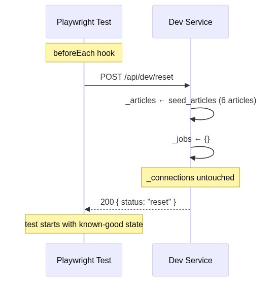

# Contract — Dev Service

**Prefixes:** `/api/dev`, `/health`
**Swagger:** [swagger-dev.yaml](../backend/swagger-dev.yaml)
**Purpose:** Test isolation and server health probe. Not exposed in production.

> Gate in production with `APP_ENV=dev` or equivalent env flag.
> Connection credentials intentionally survive `POST /api/dev/reset`
> (they outlive article state in real usage too).

---

## Endpoint inventory

| Method | Path | Action | Used by |
|--------|------|--------|---------|
| `POST` | `/api/dev/reset` | Restore `_articles` + `_jobs` to seed | Playwright `beforeEach` |
| `GET` | `/health` | Confirm server is up | Playwright `webServer`, CI |

---

## 1. Test reset — `beforeEach` hook

Restores articles and jobs to seeded defaults (6 articles, no pending jobs).
Connections are **not** reset — they hold user secrets.



---

## 2. Health check — readiness probe

Used by `playwright.config.js → webServer.url` to wait for the server before running tests.


