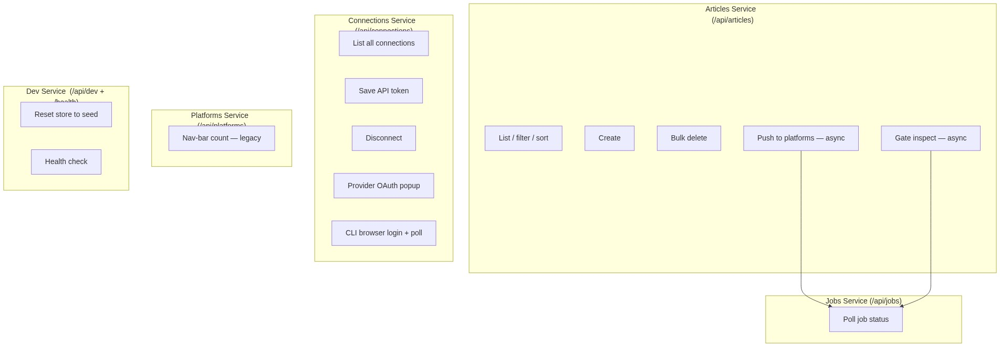
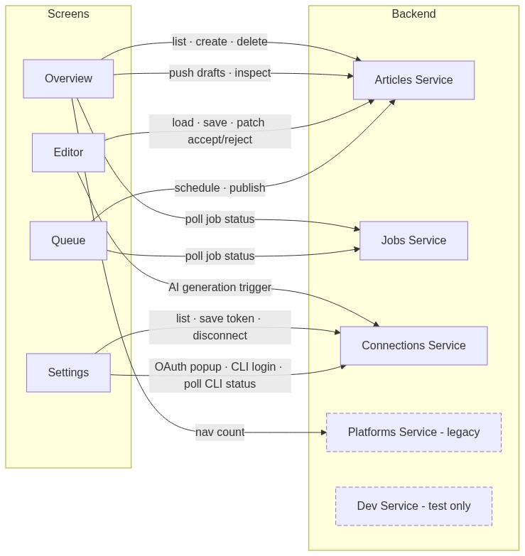

# Contract — Frontend ↔ Backend Interactions

> This folder documents every frontend ↔ backend interaction, split by service boundary.
> Each service maps to a FastAPI router and a logical domain.
> See each service file for full sequence diagrams.

---

## Service Boundaries

The BlogHub backend is a single FastAPI process but is logically partitioned into five services
by domain responsibility. Each service owns a distinct URL prefix and a slice of the in-memory store.

| Service | Prefix | Domain | File |
|---------|--------|--------|------|
| **Articles** | `/api/articles` | Article CRUD, async push & inspect | [articles-service.md](articles-service.md) |
| **Connections** | `/api/connections` | Platform & AI credentials, OAuth, CLI login | [connections-service.md](connections-service.md) |
| **Jobs** | `/api/jobs` | Async job status polling | [jobs-platforms-service.md](jobs-platforms-service.md) |
| **Platforms** | `/api/platforms` | Legacy nav-bar connectivity count | [jobs-platforms-service.md](jobs-platforms-service.md) |
| **Dev** | `/api/dev`, `/health` | Test isolation, health probe | [dev-service.md](dev-service.md) |

### Why these groupings?

**Articles** owns all article lifecycle operations. Push and inspect are async — they return
a `jobId` immediately; the **Jobs** service is the polling counterpart.

**Connections** owns all credential management — token-based (API key / PAT), browser-OAuth
(provider Authorization Code flow), and CLI-based browser login (Anthropic / OpenAI CLIs).
It is intentionally decoupled from Articles: credentials outlive article resets.

**Platforms** is a legacy read-only list kept for the nav-bar "N connected" widget on earlier
screen versions. New UI work should use `/api/connections` instead.

**Dev** is test-only infrastructure — never exposed in production.

---

## Screen → Service Map

---

## Async Action Pattern (shared by Articles + Jobs)

Any endpoint that might call an external service (platform API, AI CLI) returns `202 Accepted`
with a `jobId`. The frontend polls `/api/jobs/{jobId}` until `status` is `done` or `error`.

