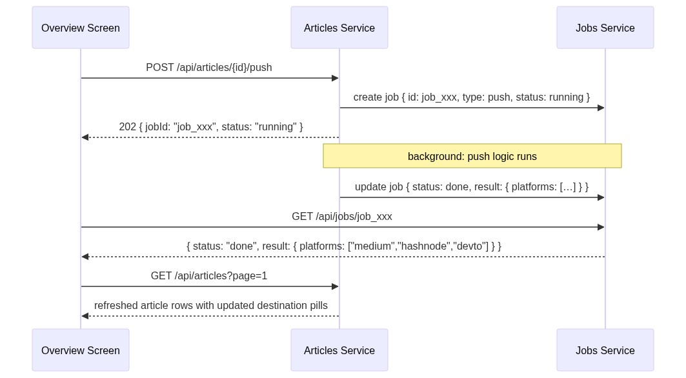
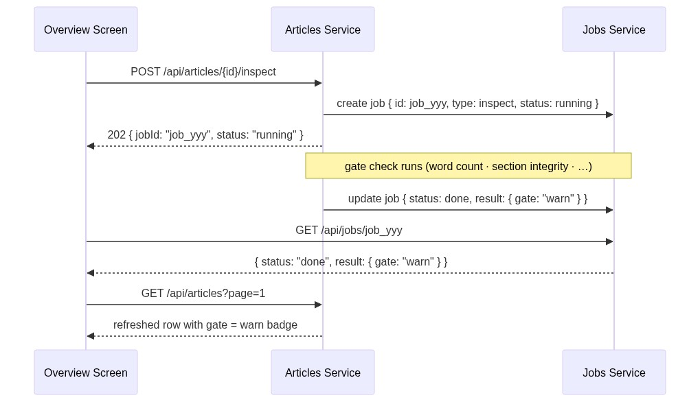

# Contract — Jobs & Platforms Services

**Prefixes:** `/api/jobs`, `/api/platforms`
**Swagger:** [swagger-jobs-platforms.yaml](../backend/swagger-jobs-platforms.yaml)
**Store:** `backend/store/memory.py → _jobs`, `_connections`

---

## Jobs Service

**Prefix:** `/api/jobs`
**Purpose:** Poll the status of any async operation started by `/push` or `/inspect`.
Jobs are created by the Articles service and consumed via polling by the frontend.

### Why a separate service?

Push and inspect may call external platform APIs or AI CLIs that can take several seconds.
Rather than holding HTTP connections open, the server returns `202 Accepted` with a `jobId`.
The Jobs service provides a single, uniform polling surface for all async operations,
keeping the Articles service response contracts simple and idempotent.

### Endpoint

| Method | Path | Action |
|--------|------|--------|
| `GET` | `/api/jobs/{job_id}` | Get current status + result of a job |

---

## 1. Job status poll — shared pattern

This diagram is the canonical reference for all async action polling in BlogHub.
Both `/articles/{id}/push` and `/articles/{id}/inspect` use this pattern.

![diagram-1](https://mermaid.ink/img/c2VxdWVuY2VEaWFncmFtCiAgICBwYXJ0aWNpcGFudCBVSQogICAgcGFydGljaXBhbnQgSiBhcyBKb2JzIFNlcnZpY2UKCiAgICBOb3RlIG92ZXIgVUk6IGFmdGVyIHJlY2VpdmluZyAyMDIgZnJvbSBwdXNoIG9yIGluc3BlY3QKICAgIGxvb3AgZXZlcnkgMiBzIChtYXggNjAgcykKICAgICAgICBVSS0-Pko6IEdFVCAvYXBpL2pvYnMve2pvYklkfQogICAgICAgIGFsdCBzdGF0dXM6IHJ1bm5pbmcKICAgICAgICAgICAgSi0tPj5VSTogeyBqb2JJZCwgdHlwZTogInB1c2gifCJpbnNwZWN0Iiwgc3RhdHVzOiAicnVubmluZyIsIHJlc3VsdDogbnVsbCB9CiAgICAgICAgICAgIE5vdGUgb3ZlciBVSToga2VlcCBzcGlubmVyIGFjdGl2ZQogICAgICAgIGVsc2Ugc3RhdHVzOiBkb25lCiAgICAgICAgICAgIEotLT4-VUk6IHsgam9iSWQsIHR5cGUsIHN0YXR1czogImRvbmUiLCByZXN1bHQ6IHsg4oCmIH0gfQogICAgICAgICAgICBOb3RlIG92ZXIgVUk6IHN0b3AgcG9sbGluZzsgYXBwbHkgcmVzdWx0IHRvIFVJCiAgICAgICAgZWxzZSBzdGF0dXM6IGVycm9yCiAgICAgICAgICAgIEotLT4-VUk6IHsgam9iSWQsIHR5cGUsIHN0YXR1czogImVycm9yIiwgZXJyb3I6ICJtZXNzYWdlIiB9CiAgICAgICAgICAgIE5vdGUgb3ZlciBVSTogc3RvcCBwb2xsaW5nOyBzaG93IGVycm9yIHRvYXN0CiAgICAgICAgZWxzZSBqb2JJZCBub3QgZm91bmQKICAgICAgICAgICAgSi0tPj5VSTogNDA0CiAgICAgICAgICAgIE5vdGUgb3ZlciBVSTogdHJlYXQgYXMgZXJyb3I7IHN0b3AgcG9sbGluZwogICAgICAgIGVuZAogICAgZW5kCiAgICBOb3RlIG92ZXIgVUk6IHRpbWVvdXQgYWZ0ZXIgNjAgcyDigJQgc2hvdyAiT3BlcmF0aW9uIHRha2luZyB0b28gbG9uZyIgdG9hc3Q=)

### Result payload by job type

| `type` | `result` shape when `done` |
|--------|---------------------------|
| `push` | `{ platforms: ["medium", "hashnode"] }` — platforms successfully pushed |
| `inspect` | `{ gate: "pass" \| "warn" \| "fail" }` — overall gate result |

---

## 2. Push job — full lifecycle

Shows how the Jobs service record moves through states alongside the Articles service.



---

## 3. Inspect job — full lifecycle



---

## Platforms Service (Legacy)

**Prefix:** `/api/platforms`
**Purpose:** Read-only list of blog platform connectivity for the nav-bar "N connected" badge.
**Status:** Legacy. Prefer `/api/connections` for all new UI work — it is credential-aware
and live, whereas `/api/platforms` returns seed-state data.

### Endpoint

| Method | Path | Action |
|--------|------|--------|
| `GET` | `/api/platforms` | Return connectivity status for Medium · Hashnode · Dev.to |

---

## 4. Nav-bar platform count


