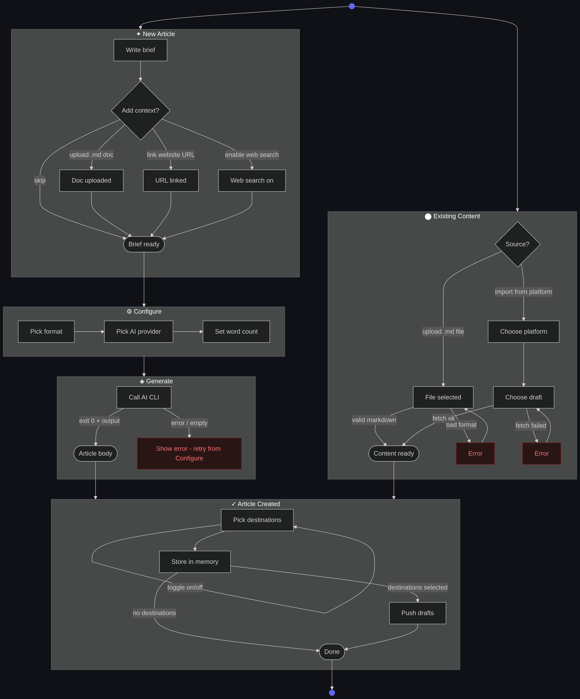

# Create Article — State Diagram

Two entry paths diverge after their source step. Only the **New Article** path goes through Configure and Generate; existing content lands directly in Done.

## Path summary

| Path | Configure + Generate | Notes |
|------|----------------------|-------|
| New article | Yes | Brief is the AI prompt; format, provider, and word count are set in Configure |
| Upload existing | No | File body stored as-is; no AI rewrite |
| Import existing | No | Fetched body stored as-is; no AI rewrite |

Context enrichment (document upload, URL link, web search) is only available on the **New article** path.
Destination selection and push happen in the Done step for both paths.
