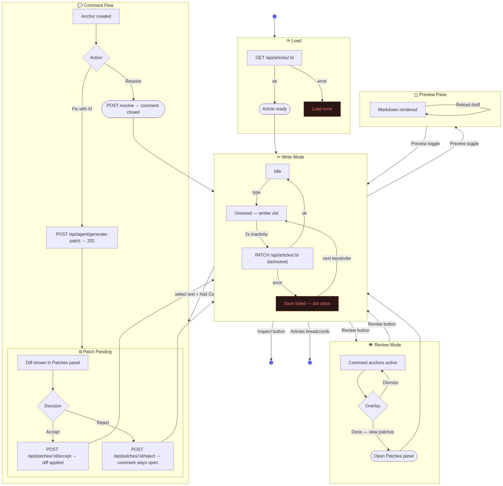

# Editor — State Diagram

Write mode is the default after load. Review mode is a toggle. The comment and patch flow is a sub-flow that starts in Write mode and returns to it on completion.

## State summary

| State | Description |
|-------|-------------|
| Write — Idle | No pending changes. |
| Write — Unsaved | Edit made, autosave armed (2 s debounce). Amber dot visible. |
| Write — Autosaving | PATCH in flight. |
| Write — Save error | PATCH failed. Dot stays. Retries on next keystroke. |
| Review | Comment anchors active. Overlay with Done/Dismiss actions. |
| Comment | Anchor placed, thread open. Fix with AI or Resolve. |
| Patch Pending | AI-generated diff visible. Accept applies; Reject discards. |
| Preview | Right pane showing rendered markdown. Orthogonal to Write/Review. |
