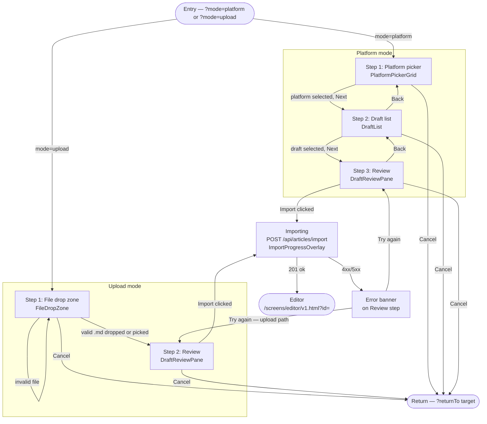

# Import Article — State Diagram

Two modes share the same screen. Mode is set on entry via query param and does not change during the session.

---

## Diagram

---

## State summary

| State | Description |
|-------|-------------|
| Platform picker | Connected platform cards. Next activates when a platform is selected. Disconnected platforms are non-selectable. |
| Draft list | Paginated draft rows for selected platform. Next activates when a draft row is selected. Load more appends rows. |
| Review (platform) | Title (editable), word count, source label, markdown preview. Import fires the POST. |
| File drop zone | Drag-and-drop or click-to-browse. Accepts `.md` only. Invalid type stays in this state with an error. |
| Review (upload) | Same layout as Review (platform). Title pre-filled from first `# heading`. |
| Importing | POST /api/articles/import in-flight. Overlay shown. All actions disabled. |
| Error | Inline banner above footer. Try again re-arms the Import button. Cancel still works. |
| Done | Navigation to editor. Screen is unmounted. |
| Cancel | Navigation to `returnTo` target (overview or create-article). |

---

## returnTo routing

| Entry URL param | Cancel navigates to |
|-----------------|---------------------|
| `returnTo=overview` | `/screens/overview/v3.html` |
| `returnTo=create-article` | `/screens/create-article/v1.html` |
| (missing) | `/screens/overview/v3.html` (default fallback) |
