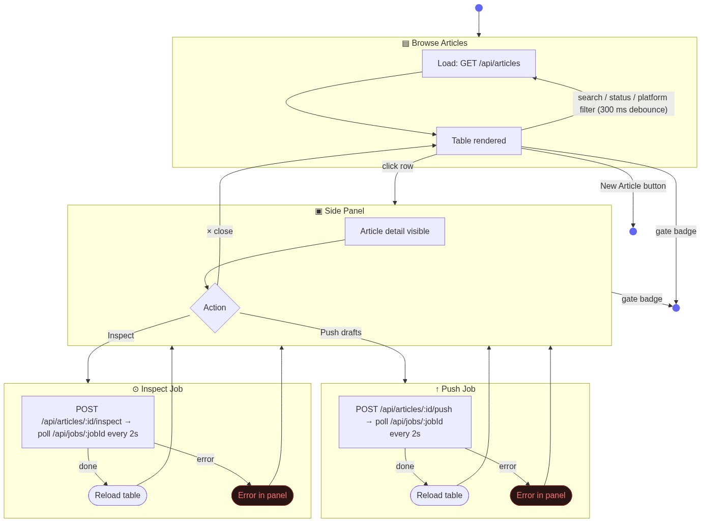

# Overview — State Diagram

The view has two stable states: browsing the article list (with optional filter) and an article selected with the side panel open. Async jobs (push, inspect) run from the selected state and return to it on completion.

## State summary

| State | Description |
|-------|-------------|
| Browse | Article list visible, no selection. Filters apply immediately via debounced reload. |
| Side Panel | One article selected. Push and Inspect actions available. |
| Push Job | Async: POST + job poll. Returns to Side Panel on done or error. |
| Inspect Job | Async: POST + job poll. Returns to Side Panel on done or error. |

Clicking the gate badge navigates to the Inspection view (out of scope here).
Clicking New Article navigates to Create Article (out of scope here).
