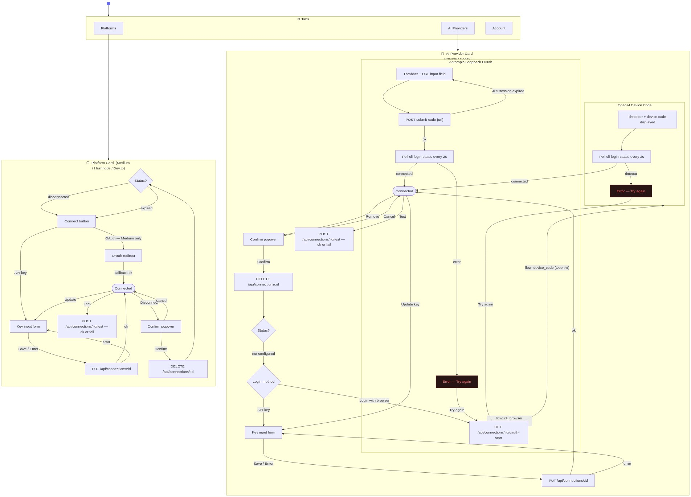

# Settings — State Diagram

Settings has three tabs. Platform cards and AI Provider cards each have their own connection state machines. Only one key input form or confirm popover can be open at a time across all cards.

## State summary

### Platform card

| State | Description |
|-------|-------------|
| Disconnected / Expired | Connect button visible. Expired shows a warning badge. |
| Key form open | Inline API key input. Save arms PUT. Cancel collapses. |
| OAuth redirect | External tab opens. Callback re-renders card as Connected. |
| Connected | Test, Update, Disconnect actions available. |
| Confirm popover | Disconnect confirmation. Cancel returns to Connected. |

### AI Provider card

| State | Description |
|-------|-------------|
| Not configured | Choose between API key or browser login. |
| Key form open | Same as Platform key form. |
| Anthropic loopback | Throbber shows URL + callback input. User pastes address-bar URL. Polling runs in background. |
| OpenAI device code | Throbber shows device code. User enters it on OpenAI's page. Polling runs in background. |
| Polling | cli-login-status polled every 2 s until connected or timeout. |
| Connected | Test, Update key, Remove actions available. |
| Confirm popover | Remove confirmation. Cancel returns to Connected. |
