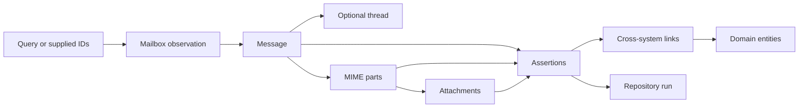

# Gmail structure

This view answers how Gmail objects become bounded financial evidence without adding guarantees beyond the contract.

Discovery records what was searched and whether coverage is complete. Native records state which source was observed. Assertions state what was extracted and where. Cross-system links connect assertions to domain entities. Repository runs preserve normalization and review state, not the Gmail original.

The December 2025 example starts with five supplied IDs, not a query. It has six attachment identities but no thread IDs, MIME capture, or attachment hashes. It proves candidate coverage only.
