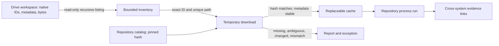

# Modeling views

The Google Drive model has two complementary views:

- [Financial Workspace folder topology](../../model/systems/google-drive/structure.md) records the implemented remote hierarchy observed on 2026-09-13, its stable IDs, filing boundaries, and the intended target hierarchy.
- The acquisition view below shows how Drive authority becomes a verified, replaceable repository input without transferring native ownership.

The implemented catalog is JSON in `config/cashflow/sources.yaml`. Its 30 records include 22 SSKM statements, three PayPal statements, three Revolut statements, one DKB statement, and one KfW balance document. Each record carries native/namespaced identity, locators, observed metadata, coverage basis, paths, size, SHA-256, and derived artifacts. `drive_inventory.json` is the dated metadata input; year manifests associate legacy files with Drive IDs.

This is an indexed subset, not a complete Drive tree, account register, or period-coverage assertion. The [folder topology](../../model/systems/google-drive/structure.md) is the normative structural view. The representative fixture under the [Google Drive integration](example/README.md) provides local examples of that structure but does not replace the model.
