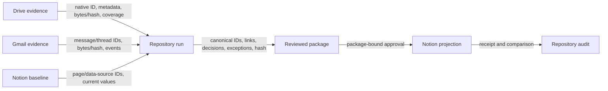

# Cross System structure

This view answers where facts originate and what accompanies them across boundaries.

Drive and Gmail remain authoritative for originals. The repository owns normalization, links, decisions, gaps, and runs. Notion owns native presentation. A Drive review folder may hold a frozen package but not the only manifest or decisions. Failures return as explicit gaps or exceptions.
