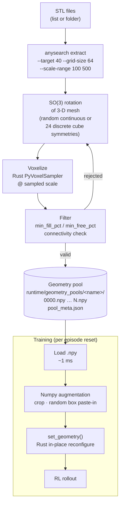

# RL Training Diversity

Improving agent generalisation by training across varied geometries, scales, and
augmented observations rather than a single fixed map.

---

## Motivation

Training on a single STL at a fixed scale causes agents to overfit to one
geometry — they learn to recognise specific corridors rather than general
spatial structure. Three complementary mechanisms fix this:

| Mechanism | What it prevents |
|---|---|
| Geometry pool | Memorising one map's layout |
| Scale sampling | Exploiting one voxel resolution |
| Observation augmentation | Over-relying on exact occupancy patterns |

All three are opt-in via env config keys and do not affect the action/obs space
contract, so they are transparent to the algorithm and model.

---

## 1 — Geometry Pool

Instead of `env.stl_path` (fixed for the whole run), the env loads from a
**pre-generated geometry pool** on disk. On each `reset()` one `.npy` file is
sampled and the Rust env is reconfigured in-place — no voxelization at runtime.

The pool is built once with `anysearch extract` (see §5). The runtime config
only needs to point at the pool directory:

```yaml
env:
  geometry_pool:
    pool_dir: runtime/geometry_pools/highres
    augmentation:
      paste_boxes:
        num_boxes: [2, 12]
        box_min_size: [2, 2, 2]
        box_max_size: [20, 20, 20]
```

`env.stl_path` continues to work for simple single-geometry runs without a pool.

---

## 2 — Scale Sampling

When the agent sees the same geometry at different voxel scales it must learn
geometry-level navigation rather than pixel-level pattern matching.

### Config schema

```yaml
env:
  scale: 40.0                  # fixed (existing behaviour)

  # --- OR ---

  scale_range: [20.0, 60.0]    # sample uniformly per episode
```

When `scale_range` is set, the wrapper re-voxelises the selected STL geometry
at the sampled scale before each episode. Because the Rust env is already
initialised with a geometry, a `set_scale(scale)` call triggers a re-voxelise
in-place without reinstantiating the env.

### Interaction with random_boxes

`random_boxes` entries have no STL to re-scale; `scale_range` is ignored for
those pool entries. Each pool entry independently chooses whether it has a fixed
or sampled scale.

Per-entry scale override:

```yaml
entries:
  - type: stl
    path: usage/geometries/stepped_terrain.stl
    scale_range: [100.0, 500.0]
  - type: stl
    path: usage/geometries/corridor_l.stl
    scale: 200.0               # fixed for this entry
```

---

## 4 — Full YAML Example

```yaml
experiment:
  name: ppo-diverse

env:
  obs_mode: box
  box_radius: 2
  agent_count: 4
  max_steps: 200
  step_cost: -0.01
  goal_reward: 1.0
  distance_shaping: 0.1

  geometry_pool:
    pool_dir: runtime/geometry_pools/highres   # built with: anysearch extract usage/extract/highres.yaml
    augmentation:
      paste_boxes:
        num_boxes: [2, 12]
        box_min_size: [2, 2, 2]
        box_max_size: [20, 20, 20]

training:
  algorithm: ppo
  iterations: 500

algorithm_config:
  lr: 3.0e-4
  train_batch_size: 4096

model_config:
  custom_model: voxel_box_3d_cnn_pretrained
  custom_model_config:
    pretrained_encoder: r2:v1
    freeze_encoder: false
    fc_hiddens: [256, 256]

mlflow: {}
```

---

## 5 — Geometry Pool: `anysearch extract`

The heavy voxelization work is done **once offline** by `anysearch extract`, which
writes a pool of ready-to-use voxel grids to disk. Training workers then load from
this pool at reset — no voxelization at runtime.

The pipeline splits responsibility cleanly:

| Stage | When | What |
|---|---|---|
| **`anysearch extract`** | Once, before training | SO(3) rotation of STL mesh → voxelization → save `.npy` |
| **Training reset** | Every episode | Load `.npy` → cheap numpy augmentation (crop, noise, paste) → `set_geometry()` |

Crops, noise, and paste-in do **not** require re-voxelization — they operate on the
already-voxelized grid in numpy, so they are ~1 ms and safe to run per episode.

---

### Pipeline diagram



---

### `anysearch extract` command

```bash
# All STLs in a folder, 40 base geometries each
anysearch extract usage/geometries/ --target 40 --grid-size 64 \
    --scale-range 100 500 --rotate --pool-dir runtime/geometry_pools/highres

# Explicit STL list
anysearch extract stepped_terrain.stl pipe_junction.stl \
    --target 40 --grid-size 32 --scale-range 20 80 \
    --pool-dir runtime/geometry_pools/lowres

# Resume interrupted run
anysearch extract usage/geometries/ --target 40 --resume \
    --pool-dir runtime/geometry_pools/highres
```

`--target N` is the number of **base** voxel grids to produce per STL. With
`--rotate` active, each STL is randomly rotated in SO(3) before voxelization so
the N outputs represent N distinct orientations × random scales.

Crops, noise, and paste-in are **not** applied here — they are training-time ops
and do not require the full voxelization to be re-run.

---

### Extraction config schema

```yaml
# usage/extract/highres.yaml
extract:
  pool_dir: runtime/geometry_pools/highres
  target_per_source: 40        # base geometries per STL
  grid_size: 64
  scale_range: [100.0, 500.0]
  rotate: true                 # random SO(3) rotation of mesh before voxelization
  workers: 8                   # parallel Ray workers
  min_fill_pct: 5.0            # reject if < 5% filled
  min_free_pct: 10.0           # reject if < 10% free (agents need room)
  connectivity_check: true     # reject if largest connected component < 80% of free cells
  sources:
    - usage/geometries/stepped_terrain.stl
    - usage/geometries/pipe_junction.stl
    - usage/geometries/cube.stl
```

Or pass a folder directly on the CLI; all `*.stl` files are used.

---

### Pool directory layout

```
runtime/geometry_pools/highres/
├── pool_meta.json         ← generation config, per-source counts, grid_size
├── stepped_terrain/
│   ├── 0000.npy           ← uint8 (64, 64, 64) voxel grid
│   ├── 0001.npy
│   └── ...                ← up to target_per_source files
├── pipe_junction/
│   └── ...
└── cube/
    └── ...
```

Each `.npy` is `uint8`, shape `(grid_size, grid_size, grid_size)`, 1 = filled, 0 = free.

---

### Training-time augmentation (no voxelization)

Applied per episode in `MultiVoxelEnv.reset()` on the loaded numpy grid.
These are cheap numpy ops — no Rust, no STL loading.

| Op | Cost | Effect |
|---|---|---|
| **Crop** | ~0.1 ms | Extract a `grid_size³` sub-volume at a random valid offset |
| **Random box paste-in** | ~0.1 ms | Place N random solid boxes inside the free space, narrowing navigable area |

Random boxes (`num_boxes`, `box_min_size`, `box_max_size`) are added as obstacles
on top of the base voxel grid. Each reset samples fresh box positions, giving the
agent a different obstacle layout from the same underlying geometry. This replaces
the `random_boxes` geometry type from the pool — boxes are a training-time modifier,
not a separate geometry source.

Config in the RL experiment YAML:
```yaml
env:
  geometry_pool:
    pool_dir: runtime/geometry_pools/highres
    augmentation:              # applied at reset, not during extract
      paste_boxes:
        num_boxes: [2, 12]
        box_min_size: [2, 2, 2]
        box_max_size: [20, 20, 20]
        prob: 1.0              # apply every episode (set < 1.0 for stochastic)
```

---

### Startup integration with `anysearch run`

```
t=0s    anysearch run r3_highres_finetune.yaml --tag v1
t=2s    Pool check: 120 / 40 variants found in pool_dir → OK, starting workers
t=5s    12 RLlib workers spawned, each maps pool files into memory
t=10s   Training: iter 1 complete  reward=-0.43
```

If `pool_dir` is missing or has fewer than `min_ready` entries (default: 10 per source),
`anysearch run` prints an error and exits:

```
Error: geometry pool 'runtime/geometry_pools/highres' has only 3 variants
       (need ≥ 10 per source). Run first:

  anysearch extract usage/extract/highres.yaml
```

---

## 7 — Implementation Checklist

### `anysearch extract` command

- [ ] `anysearch extract <stl-or-folder> [--target N] [--grid-size G] [--scale-range lo hi] [--rotate] [--pool-dir <dir>] [--workers N] [--resume]`
- [ ] YAML config path (`usage/extract/*.yaml`) as alternative to CLI flags
- [ ] `GeometryExtractor` — Ray-parallel worker: rotate mesh → voxelize → filter → save `.npy`
- [ ] Atomic write (temp + rename) — partially-written files never read
- [ ] Resume support — skip already-written `.npy` files
- [ ] `pool_meta.json` — generation config, per-source counts, grid_size
- [ ] `min_fill_pct` / `min_free_pct` / `connectivity_check` filters
- [ ] `anysearch run` pool validation — error with `anysearch extract` hint if pool missing or too small

### Runtime env pool

- [ ] `GeometryPool` class (`environments/geometry_pool.py`) — mmap index, `sample()`, background file poller
- [ ] `PyMultiVoxelEnv.set_geometry(filled_cells)` Rust binding — reconfigure in-place without teardown
- [ ] Update `MultiVoxelEnv.__init__` to build `GeometryPool` when `pool_dir` present
- [ ] Update `MultiVoxelEnv.reset()` to call `geo_pool.sample()` + apply numpy augmentation + `set_geometry()`
- [ ] Backward-compat: `stl_path` + `scale` still work (single-scale, no pool)
- [ ] `scale_range` + `stl_path` without pool: warn user to run `anysearch extract` first

### Training-time geometry augmentation

- [ ] `paste_boxes` in `MultiVoxelEnv.reset()` — numpy box overlay on loaded grid, sampled fresh each episode
- [ ] Same in `VoxelEnv.reset()`

### Settings / config loader

- [ ] Extend `EnvConfig` with `geometry_pool` (pool_dir, pool_size, sources, filters)
- [x] `scale_range` wired in `MultiVoxelEnv.reset()`
- [x] `obs_noise_prob`, `obs_cutout_count`, `obs_cutout_size` in `EnvConfig`

### Rust side

- [ ] `PyMultiVoxelEnv.set_geometry(filled_cells: Vec<(u32,u32,u32)>)` — reconfigure geometry in-place
- [ ] `PyVoxelEnv.set_geometry(...)` — same for single-agent env
- [ ] `reset_random(seed, box_config)` — procedural geometry path from Rust side

### New example configs

- [ ] `usage/experiments/train/ppo_diverse.yaml` — multi-map + scale + augmentation
- [ ] `usage/experiments/tune/ppo_diverse_asha.yaml` — ASHA tune over the diverse training setup

---

## 8 — Design Notes

**Why pre-load pool envs instead of re-instantiating?**
STL voxelisation takes 50–500 ms depending on mesh complexity. With 4–8 parallel
env workers each resetting hundreds of times, re-loading the STL every episode
would dominate wall time. Pre-loading amortises the cost to once per worker startup.

**Why not augment inside the model?**
Augmenting in the env wrapper means:
- It applies regardless of model choice (FC policy, CNN, pretrained encoder)
- Evaluation / replay envs can opt out via `training_only: true`
- No changes needed to any model code

**rotate90 is off by default for obs augmentation**
Unlike the garden (where ground truth is symmetric), in RL a 90° rotation changes
the relationship between the observation and the agent's action space (action 0 =
move +X, but after rotation +X looks like +Y). Enabling it requires either
rotating the action too (not feasible without world-model knowledge) or accepting
that the policy must learn rotation invariance implicitly. For now, `flip` is
safe (axis-aligned flips are consistent with the action space), `rotate90` is
off by default.

**Scale range interaction with box_radius**
The agent's `local_grid` is always `(2*box_radius+1)³` regardless of scale.
Changing scale changes how many *real-world* units each voxel represents, not the
obs tensor shape. The obs space contract is preserved.
