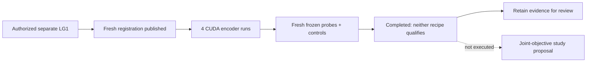

# LG1 completion evidence

The frozen protocol is the [LG1 specification](https://github.com/amadou-6e/specs/blob/062acdd3964c50c9d9c588734073d340a21ccf2e/projects/theseo-anysearch/python/perception-encoder-local-geometry.md).
This evidence changes neither the protocol nor the topology stop rule.

Four CUDA pretraining runs and fresh frozen-feature assessments completed in
206.328 seconds on RTX 3060 Ti. Both recipes are `not_qualified`: retain evidence,
do not promote either recipe or advance P1-P8. This is completed training, not
an infrastructure or calibration-only result.

| Metric | Occupancy seeds 0 / 1 | ESDF seeds 0 / 1 |
| --- | --- | --- |
| Hidden occupied IoU | 0.9269 / 0.9354 | 0.8837 / 0.8033 |
| Hidden exact boundary F1 | 0.7811 / 0.8043 | 0.7146 / 0.5914 |
| Observed-free clearance NMAE | 0.1904 / 0.1833 | 0.0515 / 0.0553 |
| Hidden-free recovery NMAE | 0.2023 / 0.1793 | 0.0530 / 0.0563 |
| Local effective-rank fraction | 0.20204 / 0.19716 | 0.24991 / 0.24587 |

Occupancy fails clearance in both seeds and recovery in seed 0. ESDF fails
boundary F1 in seed 1. All rank fractions are below the frozen 0.25 floor,
including ESDF seed 0 without rounding. No near-dead channels, hidden-input
leakage or frozen-encoder mutation were found. All comparisons against random,
zeroed, shuffled and shuffled-label controls pass the point-improvement and
paired geometry-bootstrap gates.

Raw-neighborhood boundary F1 is 0.8260/0.8216, above both recipes. ESDF is better
on clearance/recovery. Raw has 81 inputs instead of eight, so it is not a capacity-
matched architecture test. The result supports complementary objective-specific
information, not an overall architecture winner. Low covariance rank is a failed
engineering diversity bar, not proof the features contain no useful information.

Joint occupancy-plus-ESDF training is a **proposed** next hypothesis requiring
fresh preregistration and evaluation identities. It has not been run or validated.

## Evidence

- [Full report](lg1-report.json), payload SHA:
  `7f65262cb28d14d09c5943824d715a8d6b18c32a166295fb14594c16c2459b0f`.
- Frozen registration: `866c88717973894bec6982aea35d459256987379fa315d28c26d419116c43ec6`.
- Executable: `26ab4f18dafd1dcdd16f4e44f2d7db551c2892ec`.
- Pre-data publication: `fc682d2` in `amadou-6e/theseo-anysearch`.
- Implementation review: [#353](https://github.com/amadou-6e/theseo-anysearch/pull/353).

The report contains all geometry statistics, curves, controls, intervals, corpus/
query hashes and eight untracked artifact hashes. Verification replayed assessment,
checked all artifact hashes and recomputed 80 prediction/statistic pairs. The
garden suite passed 323 tests; development CUDA forward/backward and all study
integrity checks passed. No weights, raw corpora or tensor predictions are tracked.

The user's exception permits independent execution before #352/specs#28 merge,
not any PR merge. No unmerged R0 code was used. LG1 is local-feature-only,
synthetic within-generator evidence at radius eight and two seeds; no topology,
planning, global-embedding, wide-context or P1-P8 claims follow.

