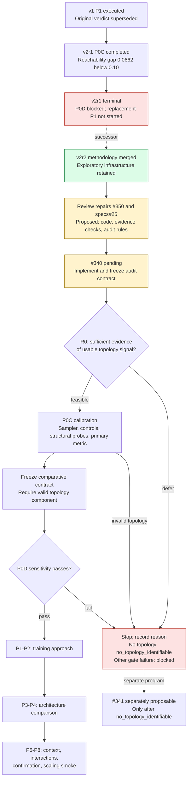

# Perception encoder state and review

Snapshot: 2026-09-08. Review repairs: specs#25 and theseo-anysearch#350.
Governing predecessor spec: `d9b260a5c677277d47776c7677fe07c2a7ff4f34`.
Reviewed implementation: `a2e9f5a87066ed663f7ea76f318d09b9177d115b`.
This snapshot is a review artifact, not an experiment result or a new run.

## Evidence and implications

| v2r1 component | Floor | Reference | Calibration outcome |
| --- | ---: | ---: | --- |
| Occupied IoU | 0.5974 | 0.9551 | Passed |
| Boundary F1 | 0.5913 | 0.9864 | Passed |
| Clearance NMAE (lower is better) | 0.2231 | 0.0913 | Passed |
| Reachability AUPRC | 0.9309 | 0.9971 | Failed 0.10 headroom |
| Geodesic NMAE | - | - | Deferred |

The reachability floor was coordinates-only. The result does not establish
linear decodability of connectivity from raw occupancy. The archived report is
`experiments/perception_encoder/results/v2r1_p0c/p0c-report.json` in the reviewed
implementation commit; payload hash:
`2564db175a1880cf81da40bd5a32e472f9b3db81bce111283fe48c74d409697b`.

## Repair inventory

1. Correct the coordinates-only diagnosis and require a sampling-shortcut audit.
2. Count unknown cells on a deterministic shortest path. The old union-of-paths
   implementation reports seven on a 3x3 open grid where every shortest path
   crosses exactly three unknown interior cells. Historical screen values stay
   non-evidential and must not be reused for v2r2 strata or thresholds.
3. Explicitly supersede the old absolute false-open and aggregate-score vetoes
   for v2r2; retain state, mask, collapse, and resource checks.
4. Require resolved numeric audit parameters, uncertainty handling, and a fixed
   primary-metric selection rule before R0. Use log base 2 for log-loss headroom.
5. Exclude entire geometry groups, including counterfactual siblings, from
   reference fitting. Keep oracle-completed inputs out of the gating reference.
6. Recompute report payload hashes before accepting prerequisite evidence.

The v2r2 topology helper is present, but its audit and comparative contract
integration is #340 work. A helper alone does not enforce the experiment boundary.
The future audit's numeric choices require review before data are opened; this
repair does not claim R0 has run or that topology is identifiable.
