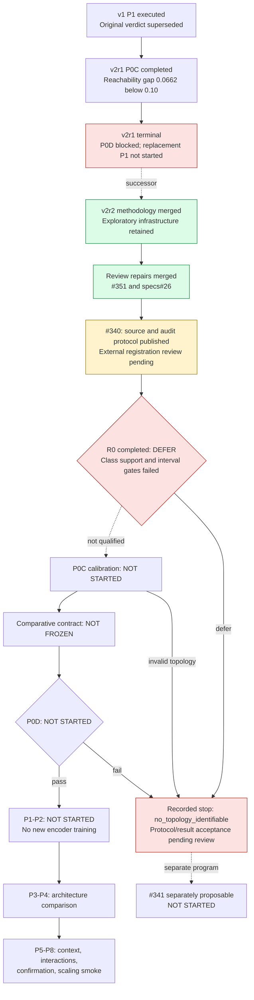

# Perception encoder state and review

Latest local-encoder followup (2026-09-13): the packaged729 code has completed
[frozen robustness and collision transfer](perception-encoder-compact-robustness-transfer.md).
See the [executed assessment](perception-encoder-compact-validation-assessment.md)
for results; the September8 topology snapshot below remains historical evidence.

Snapshot updated: 2026-09-08 after the completed R0 audit (specs#27 / implementation #340).
The original repair review used spec `d9b260a5c677277d47776c7677fe07c2a7ff4f34`
and implementation `a2e9f5a87066ed663f7ea76f318d09b9177d115b`.
Repairs are merged; R0 now has an executed result under governing spec
`0060366f43892bade5acf734cf2e189d8a666ad2` and pre-data execution registration
`a0d03c434be72d6eab7d962e53af62a7dd57b11d`.
See [the completed result and review-ordering deviation](perception-encoder-r0-result.md).
These records preserve their review state at execution time; merging the
documentation does not promote the evaluated encoder.

## Evidence and implications

R0 filled all 216 training and 144 audit geometry slots. The held-out `1-2` and
`3-5` bins had zero negative labels; `6+` failed entropy, visible-skill,
forbidden-predictability and transfer uncertainty bounds. The assessment replayed
exactly from saved predictions. This is not an architecture verdict or proof
that hidden topology is universally unidentifiable.

| v2r1 component | Floor | Reference | Calibration outcome |
| --- | ---: | ---: | --- |
| Occupied IoU | 0.5974 | 0.9551 | Passed |
| Boundary F1 | 0.5913 | 0.9864 | Passed |
| Clearance NMAE (lower is better) | 0.2231 | 0.0913 | Passed |
| Reachability AUPRC | 0.9309 | 0.9971 | Failed 0.10 headroom |
| Geodesic NMAE | - | - | Deferred |

The reachability floor was coordinates-only. The result does not establish
linear decodability of connectivity from raw occupancy. The archived report is
`experiments/perception_encoder/results/v2r1_p0c/p0c-report.json` in the reviewed
implementation commit; payload hash:
`2564db175a1880cf81da40bd5a32e472f9b3db81bce111283fe48c74d409697b`.

## Repair inventory

1. Correct the coordinates-only diagnosis and require a sampling-shortcut audit.
2. Count unknown cells on a deterministic shortest path. The old union-of-paths
   implementation reports seven on a 3x3 open grid where every shortest path
   crosses exactly three unknown interior cells. Historical screen values stay
   non-evidential and must not be reused for v2r2 strata or thresholds.
3. Explicitly supersede the old absolute false-open and aggregate-score vetoes
   for v2r2; retain state, mask, collapse, and resource checks.
4. Require resolved numeric audit parameters, uncertainty handling, and a fixed
   primary-metric selection rule before R0. Use log base 2 for log-loss headroom.
5. Exclude entire geometry groups, including counterfactual siblings, from
   reference fitting. Keep oracle-completed inputs out of the gating reference.
6. Recompute report payload hashes before accepting prerequisite evidence.

Audit and comparative contract checks are now implemented in #340, and the
registered R0 has completed. The prior snapshot requested numeric-choice review
before data opening. External review was still pending at execution; this missed
ordering is explicitly recorded in the result, not erased by this updated chart.
No comparative run is authorized by the deferred audit.
