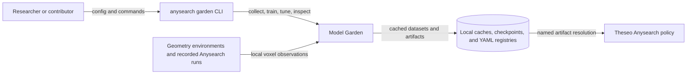

# Model Garden architecture

Model Garden turns local voxel observations into reusable encoder artifacts. It
collects and augments voxel datasets, trains encoder-decoder models, stores the
encoder portion with metadata, and makes named artifacts discoverable to external
consumers such as Theseo Anysearch.

This map describes the implementation in the `theseo-anysearch` repository at
revision `49fef5f4f9d3fb21325931e1ce1eed89e743cdcc`. Model Garden is a distinct
product boundary in the specifications, but its current Python implementation and
CLI are still physically hosted under `theseo_anysearch/garden/` and
`theseo_anysearch/cli/commands/garden.py`. The imported
[historical monolith](model-garden-monolith.md) remains migration evidence; claims
found only there are not treated as current behavior.

## Contained elements

```text
architecture/
|-- 1 README.md
|-- 1 template.md
|-- 1 SKILL.md
`-- 0..* focused architecture documents or editable diagrams
```

This is a fixed, project-level system map rather than a collection of entry folders.
Use [template.md](template.md) for a focused cross-subsystem document and
[SKILL.md](SKILL.md) when maintaining either the system map or a focused document.
Observable behavior remains owned by the relevant
[subsystem](../subsystems/README.md).

## System context

Model Garden has three external actors or systems:

- A researcher or contributor invokes the `anysearch garden` CLI with a garden or
  data YAML and inspects training, tuning, and artifact output.
- Geometry-backed Theseo environments and recorded Anysearch training runs supply
  local voxel observations. Their environment and trajectory contracts remain
  outside Model Garden.
- Theseo Anysearch policies resolve a named encoder artifact and load its weights
  and metadata. Policy construction, reinforcement learning, and inference remain
  Anysearch responsibilities.



There is no separate Model Garden service or process boundary in the current
implementation. CLI execution, collection, training, and artifact publication run in
the invoking Python process, except that tuning delegates trials to Ray workers.

## Logical components and state ownership

| Component | Responsibility | State owned | Canonical specification |
| --- | --- | --- | --- |
| [Dataset pipeline](../subsystems/dataset-pipeline/README.md) | Resolve data sources, sample local voxel grids, cache observations, split datasets, and apply online augmentation | Observation `.npz` files and source metadata under the configured cache; in-memory dataset and sampler state | Dataset-pipeline subsystem |
| [Encoder models](../subsystems/encoder-models/README.md) | Construct built-in or custom PyTorch encoders and their pretraining wrappers | Model parameters held during a run; architecture and latent-shape choices supplied by validated configuration | Encoder-models subsystem |
| [Pretraining and qualification](../subsystems/pretraining-and-qualification/README.md) | Run training or Ray Tune trials, record losses, checkpoint resumable training, and produce evidence for promotion decisions | Optimizer state, temporary checkpoints, loss curves, and Tune results | Pretraining-and-qualification subsystem |
| [Model registry](../subsystems/model-registry/README.md) | Persist encoder packages, metadata, versions, and local name-to-path discovery | Artifact directories plus local config, model, and run registry files | Model-registry subsystem |
| Anysearch integration adapter | Resolve an encoder reference and initialize the policy encoder | Policy model and its loaded encoder parameters | External consumer; Anysearch owns this integration |

The four Model Garden components are logical ownership boundaries. They currently
share one Python package and direct function calls; they are not independently
deployed services.

## Principal flows

### Dataset construction

1. `anysearch garden extract`, `train`, or a Tune trial loads a YAML document through
   the Pydantic models in `garden/data_config.py`. A garden config may contain data
   inline or refer to a separate data YAML.
2. `garden/collect.py` dispatches each source to position sampling or recorded-run
   collection. Position sampling crosses into the Anysearch environment boundary to
   obtain `local_grid` observations; recorded-run collection reads trajectory JSON.
3. Each source is keyed from its serialized configuration and cached as an
   observation archive. `garden/dataset.py` creates deterministic train/validation
   splits from the configured seed.
4. `garden/augment.py` transforms samples online as the dataset is read. The original
   cached observation archive remains unchanged.

The cache is local filesystem state. A cache hit avoids collection, while
`force_refresh` requests recollection. The current cache identity is derived from
source configuration rather than a separately versioned, immutable dataset manifest;
the dataset subsystem must own any stronger identity guarantee.

### Training and tuning

1. `garden/encoder.py` builds an autoencoder, variational autoencoder, masked-voxel
   model, or configured custom module from `GardenConfig`.
2. `garden/trainer.py` reads batches synchronously with PyTorch `DataLoader` workers
   set to zero, updates model parameters, evaluates validation loss, and applies
   early stopping. When a checkpoint path is supplied, it stores model and optimizer
   state for continuation.
3. The CLI extracts the encoder submodule and asks `GardenStore` to publish
   `model.pt`, `encoder.pt`, `meta.json`, and `loss_curve.json` in a model or tagged
   model directory.
4. `anysearch garden tune` uses `GardenTuneRunner` to run Ray Tune trials. Ray workers
   repeat collection/cache lookup, dataset construction, model creation, and training;
   the CLI can then retrain and publish the selected configuration.

Training loss and Tune selection are implemented. Whether an artifact satisfies a
research or qualification gate is evidence governed by the
[pretraining and qualification](../subsystems/pretraining-and-qualification/README.md)
and [registry certification](../subsystems/model-registry/contract/certification.md)
contracts; publication by `GardenStore.save()` alone must not be read as proof of
certification.

### Artifact discovery and consumption

1. Importing `theseo_anysearch.garden` registers package-bundled pretrained encoder
   directories in a user-local YAML registry when they are not already represented by
   a valid path.
2. Training publication adds untagged and, when supplied, tagged names to that same
   registry. `GardenStore.resolve_ref()` resolves `name`, `name:tag`, or an existing
   filesystem path.
3. Anysearch's pretrained CNN model reads `meta.json`, reconstructs the compatible
   encoder shape, loads `encoder.pt`, and optionally freezes encoder parameters.

The filesystem directory and YAML registry form the current persistence and discovery
boundary. There is no remote registry, transactional database, or cryptographic
artifact-integrity check evidenced in the inspected implementation.

## Cross-boundary invariants

- A consumer must construct an encoder compatible with the artifact metadata before
  loading its state dictionary. Model Garden owns package metadata and weights;
  Anysearch owns policy compatibility and initialization behavior.
- The voxel observation radius and tensor layout used for dataset construction must
  agree with the encoder architecture and with the consuming observation model.
- Source configuration, split seed, augmentation configuration, architecture, and
  training configuration affect reproducibility, but the current stored metadata does
  not establish a complete content-addressed lineage contract.
- Research conclusions and experiment gates do not become runtime architecture merely
  because their files exist. Accepted behavior belongs in the relevant subsystem
  contract and must agree with implementation.
- Filesystem registries are machine-local mutable indexes. A registered name is a
  convenience reference, not by itself an immutable artifact identity.

## Failure boundaries

| Origin | Propagation or containment | Owner |
| --- | --- | --- |
| Invalid or unresolved YAML | Pydantic validation or file access fails before collection or training | Dataset pipeline for data fields; owning subsystem for other fields |
| Missing geometry, trajectory, or cache input | Collection raises to the invoking CLI or Ray trial; no fallback source is synthesized | Dataset pipeline |
| Unsupported custom encoder or incompatible tensor shape | Construction or training fails in the Python process | Encoder models |
| CUDA exhaustion, numerical failure, or interrupted training | The local command or Ray trial fails; a supplied checkpoint may permit continuation | Pretraining and qualification |
| Missing registry entry, metadata, or checkpoint | Resolution or policy construction fails rather than silently substituting another model | Model registry and the Anysearch integration boundary |
| Concurrent or interrupted registry writes | Current YAML and artifact writes have no evidenced lock or atomic-publication protocol | Model registry; unresolved hardening gap |

## Deployment, resource, and trust boundaries

- Model Garden is presently an optional capability of the Anysearch Python
  installation, not a separately packaged download despite the intended product
  boundary.
- Dataset collection is CPU- and environment-dependent. Training selects CPU or CUDA
  in the CLI; Tune assigns CPU and fractional GPU resources per trial through Ray.
- Configuration can name a custom Python encoder class. Importing and instantiating
  that class executes trusted local code; this is an extension boundary, not a
  sandbox.
- Geometry, trajectory, YAML, checkpoint, and registry files are treated as local
  trusted inputs. The inspected code does not authenticate them.

## Maturity and known gaps

The implementation supports collection, deterministic splitting, augmentation,
built-in and custom encoders, local training, Ray Tune, local artifact storage, named
resolution, and Anysearch policy initialization. The specifications are less mature:
three subsystem entries still defer significant detail to the historical monolith,
and only the model-registry subsystem currently has a structured contract and design
set.

The following remain unresolved rather than architectural guarantees:

- Physical separation into an independently installable Model Garden package.
- A complete immutable dataset and artifact identity covering content, code, and
  configuration lineage.
- Atomic publication, locking, corruption detection, and recovery for local artifact
  and YAML registry writes.
- A fully reconciled qualification-to-publication workflow enforced by runtime code.
- Complete contracts for dataset collection, encoder extension compatibility, and
  failure presentation.

## Reading map

- [Subsystem ownership map](../subsystems/README.md)
- [Dataset pipeline](../subsystems/dataset-pipeline/README.md)
- [Encoder models](../subsystems/encoder-models/README.md)
- [Pretraining and qualification](../subsystems/pretraining-and-qualification/README.md)
- [Model registry](../subsystems/model-registry/README.md)
- [Experiment registry](../experiments/README.md)
- [Research registry](../research/README.md)
- [Python implementation guidance](../implementation/python/README.md)
- [Historical source records](../legacy/README.md)

## Focused documents

- [Repository extraction](repository-extraction.md) records the planned standalone
  boundary and its pinned experimental source snapshot.

- [Historical monolith](model-garden-monolith.md) — imported design evidence pending
  full decomposition; it is not the template for new architecture pages and is not
  authoritative over current code or subsystem contracts.
