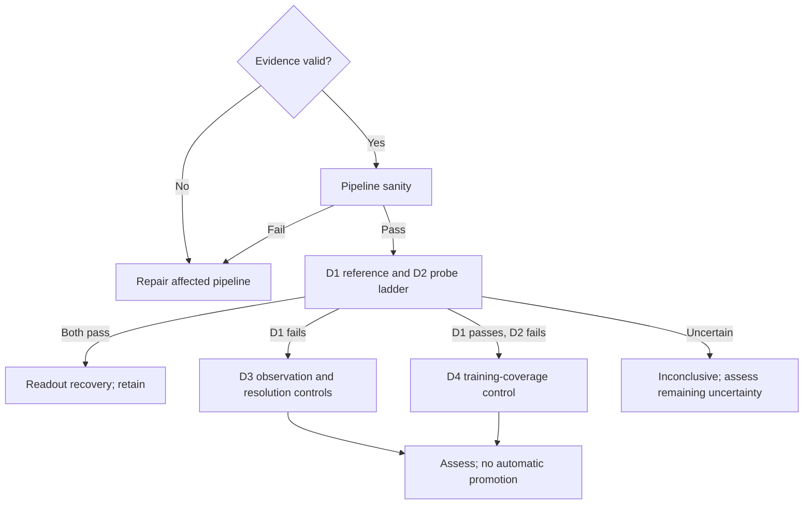

> This entry is a historical, identity-bearing preparation protocol and is not an
> authoritative specification for new Model Garden experiments.

## Archive context

### Archived material

This record preserves the preparation protocol for the D0-D2 encoder diagnostic
campaign, including its study and dataset identities, evaluation boundary, frozen
stage designs, query streams, budgets, and conditional routing rules. The original
protocol follows unchanged so its evidence and historical run identities remain
interpretable.

### Why it was archived

The campaign has been incorporated into the structured
[encoder continuation and context experiment](../../experiments/encoder-continuation-and-context/README.md).
That experiment now owns the organized protocol, execution, results, and evidence
view. This file remains a provenance source rather than current instructions.

### Authority ended

Authority ended when the diagnostic campaign was migrated into the structured
experiment entry. The original record names specs#35, theseo-anysearch#358, and
theseo-anysearch#360; the available record does not establish a more precise
migration date, so none is inferred here.

### Current replacement

The canonical owner is iteration
[001 — D0-D2 diagnostics](../../experiments/encoder-continuation-and-context/iterations/001-diagnostics/README.md).
Its execution, results, and evidence pages provide the current structured account
of the completed diagnostic work.

### Continuing evidential value

Retain this record to interpret the `voxel-encoder-diagnostics-v1` study,
`voxel-encoder-diagnostics-v1-development-1` dataset,
`voxel-encoder-diagnostics-v1-queries-1` query bank, D0-D4 stage terminology,
registered streams, historical limits, and the companion
[diagnostic evidence](perception-encoder-diagnostics-evidence.md). These identifiers
and protocol details must not be normalized to current paths or conventions.

# Encoder diagnostic campaign

Specification issue: specs#35. Implementation issue: theseo-anysearch#358.
Status: preparation protocol; not a frozen executable run registration.

Execution binding: theseo-anysearch#360. The settings below complete the preparation
choices before fitting; a hashed run registration is still required. The user
authorizes stacking on unmerged LG3/preparation work, without integration merges.

## Amendment and scope

This introduces a separate development-only campaign after the local-geometry
screens. It does not amend historical gates, supersede their verdicts, reopen the
terminated topology study, or authorize promotion. Baseline:
[LG3 specification](https://github.com/amadou-6e/specs/blob/6ed3007771514f3e893760ff7c5069028a430337/projects/theseo-anysearch/python/perception-encoder-local-geometry-lg3.md).

The methodological deviation is explicit: quality failures now select bounded
diagnostics instead of terminating all research. Validity failures still stop the
affected run. Promotion remains a separate, later confirmation decision.

## Decision categories

| Category | Examples | Action |
| --- | --- | --- |
| Validity | Leakage, split overlap, incorrect targets, changed frozen state | Repair; invalidate affected evidence; no quality interpretation |
| Diagnostic | Poor surface recovery, unstable fitting, transfer gap | Route to the specified development experiment |
| Promotion | Unconfirmed generalization or insufficient advantage | Do not promote; retain valid research evidence |

Every record contains validity, outcome, observations with per-family uncertainty,
supported and unresolved interpretations, next experiment, remaining budget and
promotion eligibility (always false for this campaign). A failed trained reference
does not prove a target is unidentifiable. A successful probe is not certification.

## Identities and evaluation boundary

Use study `voxel-encoder-diagnostics-v1`, dataset
`voxel-encoder-diagnostics-v1-development-1`, queries
`voxel-encoder-diagnostics-v1-queries-1`, and run IDs ending in `d0` through `d4`
plus a seed. Never reuse LG3 evaluation geometry or query banks for tuning.
All campaign scores are development evidence, including its held-out assessment
split. A subsequent confirmation needs fresh data and a separate registration.

Before execution freeze exact source/spec commits, checkpoint file and loaded-state
hashes for all three LG2 seeds, full geometry IDs and content hashes, mask streams,
target definitions, query banks, architecture/optimizer settings and limits.
The runner must verify them before fitting. The present preparation document alone
does not meet that execution requirement. Unmerged artifact use must be recorded.

## Prepared D0-D2 experiment design

Keep the 17-cubed lattice and 20% label-independent masking for the primary
comparison. Use 48 training, 24 selection and 48 assessment geometries, balanced
across four LG3 generator families and three density fractions, with fresh IDs.
This tests new instances of known development families, not unseen-family transfer.
Check duplicate occupancy hashes across splits; invalidate rather than redraw.
Fit normalization on training only. Use seeds 0, 1, 2 and report every seed.

Primary diagnostic: boundary prediction; occupancy and distances are supporting
checks, not additional blocking gates. Report log loss, AUPRC, positive prevalence,
F1 at 0.5, and F1 at a selection-split-calibrated threshold. Never select a threshold
on assessment. Report predictions' positive counts and per-family results.

| Stage | Design | Maximum work | Interpretation |
| --- | --- | --- | --- |
| D0 | Verified all-free/all-solid/interface fixtures; tiny mixed-label fitting fixture with explicit target feature as positive control; independent metric checks | 3 seeds, 512 updates each, 5 minutes | Positive-control training F1 >=0.99 and all label/metric invariants pass; otherwise repair |
| D1 | Supervised visible-input spatial model, no hidden occupancy or target-derived channels; query coordinates permitted | 3 seeds, 2048 updates each, 40 minutes | Establish whether useful recovery is achievable from the observation |
| D2 | Same frozen local features; linear, 32-unit and 128-unit one-hidden-layer probes; identical sampled rows to D1 | 3 seeds x 3 probes, 1024 updates per fit, 40 minutes | Distinguish registered readout capacity/fitting limitations from remaining representation gap |

D0's explicit-target positive control is confined to its fixture and must never
enter D1/D2. D1 needs enough spatial context to be a meaningful reference; it is not
an information-theoretic ceiling. D1 and D2 may execute independently after D0,
but comparisons must wait for both. Choose the D2 probe using selection log loss,
never assessment F1. Also report each capacity, including training curves and
selection loss, to expose failed fitting and overfitting.

D1 uses occupied/free/unknown channels only, four 3x3x3 Conv3d blocks of width 16,
dilations 1/2/4/1, same padding, GroupNorm(4) and SiLU, then a 1x1x1 scalar head.
The convolutional receptive field is 17; GroupNorm also uses spatial statistics.
No coordinates or clean target-derived channels enter the reference. Fit unweighted
boundary BCE using AdamW(lr=0.001, weight_decay=0.01), eight volumes per update.
D2 uses the eight local encoder channels, train-only mean/std normalization with
std floor 1e-5, linear or Linear-SiLU-Linear heads, the same AdamW and unweighted
BCE, 1024 sampled query rows per update. Final-step weights are evaluated; curves
record training and selection loss every 256 updates, without early stopping.
Selection chooses the lowest log-loss D2 capacity (ties use order linear/32/128).
Threshold selection maximizes selection F1 over 0.01..0.99 in steps of 0.01,
with ties choosing the lowest threshold. Every seed and capacity remains reported.

CPU-generated query masks use streams 36001/36002/36003 for train/selection/
assessment, with 256 uniformly sampled hidden cells without replacement per
geometry. Fewer than 256 eligible cells or fewer than 20 positive/negative boundary
rows per family invalidates the run without redraw. D0 positive-control fitting
uses a single linear layer on signed explicit labels, 64 balanced rows, AdamW
lr=0.01/weight_decay=0.01 and 512 full-batch updates. Its hand-checked boundary
fixtures mark occupied cells with an in-crop six-connected free neighbor.

This binding fits boundary only; occupancy/distance fitting is deferred rather
than multiplying the diagnostic budget. Those earlier results remain contextual
evidence, not new supporting measurements. D1 and D2 execute sequentially on the
single GPU. A timed-out stage ends this run as inconclusive, retaining completed
evidence. D3/D4 remain proposals, not automatic execution in this binding.

For D1/D2, use three-valued evidence: pass when every seed meets boundary F1 0.70
at the selection-calibrated threshold and the geometry-cluster-bootstrap 95% CI
for improvement over the train-prevalence null in log loss is strictly positive.
Fail when every seed misses the F1 bar or the upper CI for improvement is <=0.
Otherwise inconclusive. Use 2000 bootstrap draws, seed 358, resampling whole
geometries jointly across methods within family/density strata. Average paired
geometry differences over the three seeds; report seed scores separately. These
are engineering diagnostic criteria, not universal encoder quality requirements.

## Conditional routing and budget

The entire campaign has a two-hour wall-clock cap, including preparation and
assessment. Check caps before each fit and during training; exhausted or incomplete
fits are inconclusive, never passes. No automatic retries or extensions. Completed
evidence remains assessable at the cap, but no next experiment may launch.

D3 and D4 are experiment proposals, not executable authorizations in this increment.
D3 varies masking/resolution in a paired control; improvement supports observation
sensitivity, not proof of a unique cause. D4 varies training coverage while holding
architecture and compute fixed; improvement supports coverage sensitivity. Each
requires frozen intervention settings and must fit the remaining campaign budget
(at most 15 minutes per conditional stage). No D3/D4 loop is permitted. If both
reference and probe fail, D3 takes precedence; if only the reference fails, inspect
the reference as well, because successful probes demonstrate recoverable signal.

## Acceptance for preparation

- A standalone router implements these branches without modifying old contracts.
- Tests cover validity precedence, all routes, impossible stage histories, caps,
  inconclusive results, and the fact that no route promotes.
- D0-D2 are specified but clearly not reported as executed.
- Execution integration, frozen registration and GPU results remain separate work.
