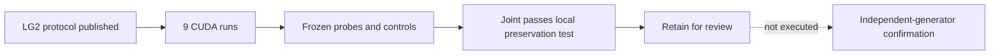

# LG2 completion evidence

> This entry is historical evidence and is not an authoritative specification.
> The structured [local-geometry encoder experiment](../../../experiments/local-geometry-encoder/README.md)
> owns the current protocol, iteration record, and interpretation of this result.

## Archived context

This record preserves the original LG2 completion assessment, including its
identity-bearing revisions, hashes, measurements, qualifications, and stated
limits. It remains useful for interpreting the preserved report and reproducing
the evidence trail. It does not authorize new execution, deployment, topology
promotion, or continuation of the historical protocol.

## Original assessment

Nine CUDA encoder runs and frozen-probe assessments completed in **444.5 seconds**.
The primary outcome is **`joint_preserves_specialists`**. Retain the joint recipe
for independent local-geometry confirmation, not deployment or topology promotion.

| Three-seed mean metric | Occupancy | ESDF | Joint |
| --- | ---: | ---: | ---: |
| Hidden occupied IoU | 0.9410 | 0.8699 | 0.9378 |
| Hidden exact boundary F1 | 0.7890 | 0.7255 | 0.8225 |
| Observed-free clearance NMAE | 0.1820 | 0.0490 | 0.0491 |
| Hidden-free recovery NMAE | 0.1771 | 0.0479 | 0.0489 |

Joint qualifies on all four absolute metrics, controls and integrity gates in all
three seeds. Occupancy fails clearance in every seed; ESDF fails boundary F1 in
seed 1 (0.6954). All 48 task/recipe/control comparisons pass; every run has zero
dead channels, zero mask-isolation error and unchanged frozen encoder state.

Joint's 95% paired geometry-bootstrap improvement intervals against the specified
specialists are IoU [-0.00979,+0.00388], boundary [+0.01461,+0.05295], clearance
[-0.00159,+0.00133], recovery [-0.00245,+0.00040]. All satisfy frozen noninferiority
margins (0.03 classification, 0.02 NMAE); every seed also satisfies its margin.
Joint seed 0 loses 0.02433 boundary F1 versus occupancy-only, so this is not a
per-seed universal superiority claim. Intervals are conditional on these seeds.

## Methodology boundary

**LG2 does not pass LG1's historical rank floor.** Joint covariance-rank fractions
are 0.17033/0.16891/0.17632, below 0.25. LG2 explicitly preregistered rank as
diagnostic before data, using [development-only fixtures](lg2-rank-fixtures.json)
that distinguish invertible scaling/useful rank-one features from constants.
Actual task/control, dead-channel and integrity gates remain mandatory. LG1's
verdict and frozen protocol are not changed, and no study features were whitened.

Joint BCE + 10*ESDF Smooth L1 is a candidate, not an optimal weighting or architecture.
The 81-input raw-neighborhood diagnostic still has mean boundary F1 slightly above
joint; its clearance/recovery NMAE is about 0.202-0.206 versus joint's 0.048-0.050.
Different capacity/receptive field prevents a capacity-matched architecture claim.

Independent-generator confirmation is **proposed, not executed**. Topology,
connectivity, planning, wide-context, global embeddings and P1-P8 remain excluded.

## Evidence

- [Frozen specification](https://github.com/amadou-6e/specs/blob/ee173bc2a61064386ee8669f77bad9ddf016b709/projects/theseo-anysearch/python/perception-encoder-local-geometry-lg2.md).
- [Full report](lg2-report.json), payload SHA:
  `a1c99cf09adc3301dbd36307575e723a094c55a1335d996761a6cc5a1f3f135a`.
- Registration: `7bf27e903a90bf1149c75dad80ea9dc88900e0e72e447957cd7ea1b32b393c25`.
- Executable: `b230fab29bec8959267e20b9d3328f907bf901dc`; pre-data publication `af472eb`.
- Implementation review: [PR #355](https://github.com/amadou-6e/theseo-anysearch/pull/355).

Execution: 9,216 encoder updates, 61,440 probe updates (120 fits), 192 fresh disjoint
geometries, fixed radius eight and 20% independent masking. RTX 3060 Ti, PyTorch
2.13.0+cu126, deterministic FP32; encoder loops took 335.858 seconds. No weights,
volumes or tensor predictions are committed; the report records their hashes and
every geometry statistic/control/interval needed to replay the assessment.

Validation: 333 garden tests, development CUDA smoke, report and 18 artifact hashes,
complete assessment replay and 180 prediction/statistic checks passed. No frozen
source or gates changed after data opening. The user explicitly authorized stacked
execution before LG1 review; no PR merges occurred. Evidence remains synthetic,
crop-local, within-generator and conditional on three seeds.

