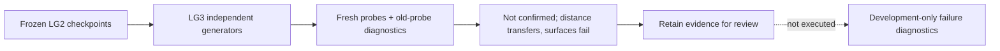

# Archived LG3 completion assessment

> This entry is historical evidence and is not an authoritative specification.

## Archived material

This record preserves the original LG3 completion assessment for the
independent-generator frozen-feature confirmation. The assessment, reported metrics,
artifact hashes, revision identifiers, and conclusions below are retained as recorded
so historical LG3 evidence can be audited without changing its meaning.

## Why it was archived

The completed LG1-LG3 sequence is now represented by the structured
[local-geometry encoder experiment](../../../experiments/local-geometry-encoder/README.md).
Its LG3 iteration separates protocol, execution, results, and evidence ownership, so
this imported assessment no longer defines the current documentation structure.

## Authority ended

Authority moved to the structured experiment when the historical LG1-LG3 material was
migrated. The exact migration date is not established by this record; the frozen
protocol commit, implementation revision, publication revision, and payload identity
below remain the authoritative provenance for the historical run itself.

## Current replacement

- [LG3 iteration](../../../experiments/local-geometry-encoder/iterations/lg3/README.md)
- [LG3 results](../../../experiments/local-geometry-encoder/iterations/lg3/results.md)
- [LG3 evidence manifest](../../../experiments/local-geometry-encoder/iterations/lg3/evidence/README.md)
- [Preserved frozen LG3 protocol](../perception-encoder-local-geometry-lg3.md)

## Continuing evidential value

Retain this assessment to interpret the LG3 report, frozen checkpoints, registration
contract, implementation revision, and publication revision. It records why LG3 was
classified as `not_confirmed`, which narrower findings survived, and which claims and
follow-up actions were explicitly excluded.

## Preserved assessment

# LG3 completion: not confirmed

The independent-generator confirmation completed in **42.829 seconds**, with
**zero encoder updates**. Primary decision: **`not_confirmed`**. Retain evidence,
do not promote a broadly confirmed encoder. LG2's narrower result stays unchanged.

| Metric | Fresh-probe mean | Unchanged LG2 probe mean |
| --- | ---: | ---: |
| Occupied IoU | 0.6414 | 0.6256 |
| Boundary F1 | 0.3029 | 0.4620 |
| Clearance NMAE | 0.0525 | 0.0556 |
| Recovery NMAE | 0.0521 | 0.0554 |

The primary path fits probes on the new domain; it is not zero-shot. The old-probe
column uses LG2 weights and normalizers without adaptation.

Pooled occupancy passes, but oblique sheets fail per-family IoU in every seed:
0.2425/0.3102/0.2700. Boundary F1 fails the absolute bar on every family and seed;
aggregate seed scores are 0.0000/0.5124/0.3963. Boundary control improvement gates
also fail through seed 0; other pooled control comparisons pass. Clearance/recovery
pass every family's absolute bars in all seeds (approximately 0.034-0.066).

Encoder-state and mask integrity pass; no channels are dead. This is not evidence
of total feature collapse. Fresh boundary fitting performs worse than unchanged
old probes on average; seed 0 predicts two positive boundaries, both wrong, among
1,241 true boundary queries. Raw-neighborhood boundary F1 is also only 0.472-0.497.
Probe optimization, task difficulty and encoder limitations are not disentangled.
No threshold or family was changed after observing this failure.

Distance transfer has component-level support; broad surface/geometry confirmation
does not. Proposed next work, not executed: separately identified development
diagnostics for sampling/aliasing, masked-target ambiguity and probe fitting,
with a fixed-budget supervised reference. Do not tune on LG3 evaluation or scale
radius/architecture on this outcome.

## Evidence

- [Frozen specification](https://github.com/amadou-6e/specs/blob/082f5b7e8979fe8e9fdf840087fa93df7c430dc2/projects/theseo-anysearch/python/perception-encoder-local-geometry-lg3.md).
- [Full report](lg3-report.json), payload SHA:
  `4ecc543fbb3cbc9fceb27be871faa6ba94a29f99778066789a2667031acb6364`.
- Registration/checkpoint contract:
  `722f883c542eb74af862b68d067d92c6fbaa860f205fbcb14bffee5b3bc055ee`.
- Executable: `21d1ea2c8f03d7def5dc5619d36d1dae5cdf2b9f`; publication `b465dc4`.
- Implementation review: [PR #357](https://github.com/amadou-6e/theseo-anysearch/pull/357).

48 fitting and 48 evaluation geometries, four new procedural families, three
density strata, radius eight, fixed independent missingness and target/query
definitions. 48 probe fits/24,576 updates, three frozen LG2 checkpoints, zero-shot
diagnostics separate. These are synthetic independent implementations, not external
real geometry or unseen families for the newly fitted probes.

343 tests pass. Input artifacts and loaded states verified before data; canonical
report and six output hashes verified; complete assessment replay and 72 prediction/
statistic checks pass. No model weights, volumes or tensor predictions are tracked.
User authorized stacked execution before merges; no PRs were merged. Topology,
planning, global-latent, wide-context and deployment claims remain excluded.

